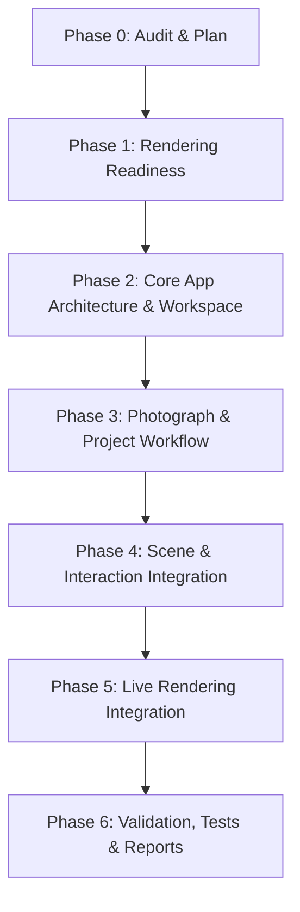

# Relight Studio — RS-PRODUCT-1.0 Implementation Plan
## Studio Workspace Engineering Execution Plan

**Document:** `RS_PRODUCT_1_0_IMPLEMENTATION_PLAN.md`  
**Milestone:** RS-PRODUCT-1.0 (Studio Workspace)  
**Baseline:** `9ad1118` (`feature/RS-PRODUCT-1.0-studio-workspace`)  
**Platform:** macOS / Apple Silicon  
**Date:** November 2026

---

### 1. Implementation Overview & Sequencing

This plan outlines the staged progression from the underlying rendering engine to a complete, usable, artist-controlled virtual lighting studio application. Each phase has strict entry and exit criteria, isolated dependencies, and evidence-backed verification gates.

```
Phase 0: Architecture Audit & Plan (Current)
    ↓
Phase 1: Bounded Verification (RS-SPIKE-3C.3.1) -> RS_PRODUCT_1_0_RENDERING_READINESS.md
    ↓
Phase 2: RS-PRODUCT-1.0A — Core Application Architecture & Studio Workspace
    ↓
Phase 3: RS-PRODUCT-1.0B — Photograph & Project Workflow (.relight bundle)
    ↓
Phase 4: RS-PRODUCT-1.0C — Scene & Interaction Integration (3D Gizmo, Tree, Inspector)
    ↓
Phase 5: RS-PRODUCT-1.0D — Live Rendering Integration (Async Orchestrator & Dual-Mode)
    ↓
Phase 6: RS-PRODUCT-1.0E — Validation, Testing & Deliverables (Full Test Suite, Screenshots, Final Reports)
```

---

### 2. Phase Breakdown and Acceptance Criteria

#### Phase 1: Bounded Rendering Readiness Verification (RS-SPIKE-3C.3.1)
- **Objective:** Verify critical rendering invariants from RS-SPIKE-3C.3 before application integration.
- **Tasks:**
  1. Verify Cook–Torrance GGX denominator clamping is intact and stable at $r \in [0.04, 1.0]$.
  2. Verify CPU–Metal parity on diffuse and specular IBL buffers ($\text{MAE} \le 1.0 \times 10^{-4}$).
  3. Verify E.1 guided-filter detail reconstruction and C3 Oklab gamut mapping paths.
  4. Verify single-scattering energy conservation ($k_d + F_0 \le 1.0$) and additive direct+IBL superposition.
  5. Verify bitwise zero-mutation on protected image regions ($0.0000000000$ error).
  6. Confirm and document 1080p host wall-clock latency characteristics.
- **Deliverable:** `RS_PRODUCT_1_0_RENDERING_READINESS.md`
- **Acceptance Gate:** All 6 checks pass; zero rendering regressions.

---

#### Phase 2: RS-PRODUCT-1.0A — Core Application Architecture & Studio Workspace
- **Objective:** Establish the production application package `relight_studio/` with the 4 workspace regions and professional dark design system.
- **Tasks:**
  1. Build `relight_studio/controller.py` (`StudioAppController`): manages application state, active project, selected object, undo/redo, and active view models.
  2. Build `relight_studio/orchestrator.py` (`RenderingOrchestrator`): asynchronous render dispatcher with thread worker pool, request debouncing, and stale-frame cancellation.
  3. Build `relight_studio/server.py` and `relight_studio/web/`:
     - Local async application server (FastAPI/Uvicorn) with WebSocket real-time event channel.
     - Dark Studio design system (`#121214` workspace background, `#18181b` panel surfaces, `#27272a` borders, clean typography, zero cartoonish/generic web elements).
     - **Region A: Photograph Viewport:** Canvas with zoom (10% to 500%), pan, fit-to-screen, 1:1 pixel view, interactive split before/after wipe slider, display mode selector (Relit, Split, Original, Specular Only, Wireframe Overlay, Luminance Heatmap).
     - **Region B: 3D Studio Viewport:** Canvas with 3D orbit, pan, zoom, ground grid, curved cyclorama cove arc, camera frustum, subject proxy wireframe, area lights with normal vectors, click-to-select, and 3D transform gizmo handles.
     - **Region C: Scene Hierarchy Tree:** Collapsible tree view showing Scene $\to$ Camera, Subject $\to$ Proxy, Receiver, Lights $\to$ Area Light 01/02, Environment; with add, remove, duplicate, toggle, rename, and selection highlighting.
     - **Region D: Context Inspector:** Clean numeric sliders and pickers for Light (Pos, Rot, Dim, Intensity, Kelvin, Convention), Material (PBR profiles, Roughness, Metallic, F0, Specular Intensity), Environment (Intensity, Rotation, Tint, Diffuse/Specular weight), and Camera.
- **Acceptance Gate:** Application launches cleanly, displays all 4 synchronized regions, and renders responsive UI states.

---

#### Phase 3: RS-PRODUCT-1.0B — Photograph & Project Workflow
- **Objective:** Enable seamless project creation, photograph import, and non-destructive persistence.
- **Tasks:**
  1. Build `relight_studio/project.py` (`ProjectManager`):
     - Create new project with default studio lighting setup.
     - Import photographic plate (JPEG, PNG, TIFF, WebP) with automatic dimensions, color profile, and default proxy alignment.
     - Bundle format `.relight` (directory bundle or compressed archive) storing `project.json`, `scene.json`, and managed assets.
     - Non-destructive guarantee: original image data is cached immutably and never overwritten.
  2. Implement Save Project, Save Project As, and Open Project:
     - Full JSON serialization of scene state, camera, lights, materials, and environment.
     - Support relative path resolution so projects can be shared across directories without breaking.
     - Provide robust missing-asset warnings and fallback recovery.
- **Acceptance Gate:** New project $\to$ Import photograph $\to$ Adjust scene $\to$ Save project $\to$ Close $\to$ Reopen project yields identical bitwise scene state and rendered output.

---

#### Phase 4: RS-PRODUCT-1.0C — Scene & Interaction Integration
- **Objective:** Connect interactive 3D gizmos, scene tree actions, and inspector controls to authoritative scene state.
- **Tasks:**
  1. Direct 3D Light Manipulation:
     - Click-to-select light quad in the 3D viewport.
     - 3D translation gizmo: drag red (X), green (Y), blue (Z) axes to reposition the light in world space.
     - Rotation gizmo: drag pitch/yaw rings to re-aim the light.
     - Scale handles: drag corner handles to adjust softbox width and height.
  2. Scene Hierarchy Integration:
     - Add new area light (automatically positioned and selected).
     - Duplicate active light with smart spatial offset.
     - Delete active light.
     - Toggle light visibility / emission state.
     - Rename light inline.
  3. Transactional Undo / Redo:
     - Group continuous drags into single undoable transactions on mouse release.
     - Instant undo/redo replay updating both viewports and the inspector simultaneously.
- **Acceptance Gate:** Manipulating gizmo updates 3D quad, photograph relighting, scene tree, and inspector synchronously without drift or lag.

---

#### Phase 5: RS-PRODUCT-1.0D — Live Rendering Integration
- **Objective:** Connect Metal GPU rendering pipeline to the application workspace with dual-mode preview/final rendering.
- **Tasks:**
  1. Integrate `MetalRenderBackend` with automatic `RenderBackend` (CPU) fallback.
  2. Implement Dual-Mode Rendering Pipeline:
     - **Interactive Preview Mode:** $1024 \times 576$ resolution, optimized Monte Carlo sampling ($4\,\text{samples/light}$), high frame rates ($> 150\,\text{FPS}$ GPU compute) for fluid interaction during dragging.
     - **Final Quality Mode:** Full image resolution ($1080\text{p}+$ or native plate resolution), high-sample Monte Carlo ($32\,\text{samples/light}$), full E.1 guided-filter detail reconstruction for final review and export.
  3. Stale-Request Cancellation & Debounce:
     - Drop obsolete in-flight preview frames when newer user inputs arrive.
     - Throttle preview updates to $60 - 100\,\text{Hz}$ to eliminate queue buildup.
- **Acceptance Gate:** Dragging lights generates fluid real-time relighting; settling the drag transitions cleanly; zero main-thread freezing.

---

#### Phase 6: RS-PRODUCT-1.0E — Validation, Testing & Deliverables
- **Objective:** Comprehensive testing, visual evidence generation, and reporting.
- **Tasks:**
  1. Author automated test suite in `tests/RS-PRODUCT-1.0/`:
     - `test_application_controller.py`: State updates, selection, undo/redo.
     - `test_project_workflow.py`: Create, import, save, load, asset preservation.
     - `test_interaction_synchronization.py`: 3D gizmo, scene hierarchy, inspector sync.
     - `test_rendering_orchestrator.py`: Async queue, debounce, stale-frame rejection.
     - `test_nondestructive_guarantees.py`: Verification that source images and protected masks remain untouched.
  2. Capture high-resolution visual evidence of all 10 required states:
     1. Empty application workspace
     2. New project
     3. Imported photograph
     4. Photograph viewport (split wipe & overlays)
     5. 3D scene viewport (with 3D gizmo and lights)
     6. Scene hierarchy (with multiple lights and selection)
     7. Light inspector (live parameters)
     8. Light selection and transformation in progress
     9. Relit photograph (high-quality output)
     10. Saved and reopened project
  3. Measure and document latency distribution, memory stability, and throughput.
  4. Author final reports:
     - `RS_PRODUCT_1_0_IMPLEMENTATION_REPORT.md`
     - `RS_PRODUCT_1_0_VALIDATION_REPORT.md`
     - `RS_PRODUCT_1_0_PERFORMANCE_REPORT.md`
- **Acceptance Gate:** 100% test pass rate, all 10 screenshots verified on disk, reports complete, clean git history.

---

### 3. Dependency Graph



### 4. Git Commit Milestone Schedule
1. `docs: add product architecture audit and implementation plan (RS-PRODUCT-1.0)`
2. `docs: add rendering readiness verification report (RS-SPIKE-3C.3.1)`
3. `feat: establish core application architecture and studio workspace (RS-PRODUCT-1.0A)`
4. `feat: implement photograph import and project bundle persistence (RS-PRODUCT-1.0B)`
5. `feat: implement 3D gizmo interaction and scene hierarchy sync (RS-PRODUCT-1.0C)`
6. `feat: connect live Metal rendering orchestrator with dual preview/final mode (RS-PRODUCT-1.0D)`
7. `test: add comprehensive application and workflow test suite (RS-PRODUCT-1.0E)`
8. `docs: complete implementation, validation, and performance reports (RS-PRODUCT-1.0)`
