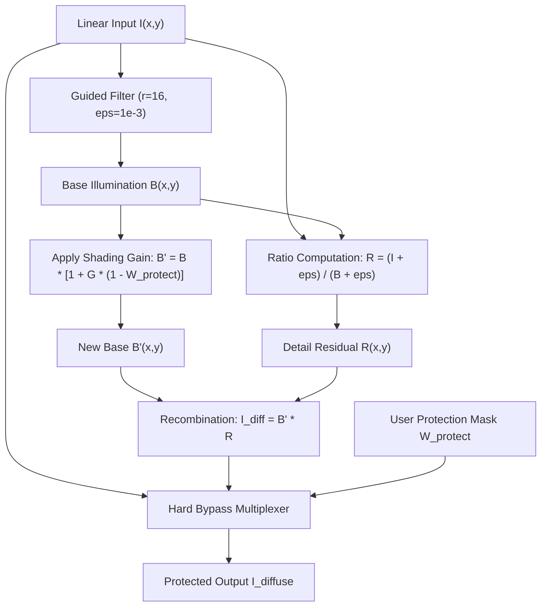

# RELIGHT STUDIO — MASTER ENGINEERING ARCHITECTURE v1.1
## Critical Architecture Review, Mathematical Validation & M0 Feasibility Programme

**Document ID:** RS-ENG-ARCH-v1.1  
**Status:** PROVISIONAL / M0 FEASIBILITY SPECIFICATION  
**Target Platform:** macOS 14.0+ (Apple Silicon Metal 3)  
**Authors:** Multidisciplinary Engineering Leadership Team  
- Principal Computer Vision Research Scientist
- Senior Computational Photography Engineer
- Physically Based Rendering (PBR) Specialist
- Metal / GPU Architecture Engineer
- Professional Colour Science Engineer
- Native macOS Systems Architect
- Image Processing and Computational Optics Researcher
- Technical Product Architect  

---

## 1. EXECUTIVE ENGINEERING VERDICT

Relight Studio's central product promise—*"Change the lighting. Preserve the product."*—cannot be delivered by treating single-image photographic relighting as an unconstrained inverse-rendering or generative problem. 

### Critical Architecture Audit Findings
1. **The Inverse Problem Fallacy:** Reconstructing 3D surface geometry, unclipped incident radiance, microfacet roughness, and spatially varying albedo from a single uncalibrated 2D photograph is mathematically ill-posed and physically underdetermined [Horn 1975; Barron & Malik 2015]. On specular, polished, or transparent luxury goods (watches, jewelry, perfume glass), monocular neural normal estimators (e.g., Omnidata, DSINE) fail catastrophically because they mistake studio softbox reflections for physical surface curvature.
2. **Generative Model Disqualification:** Generative diffusion models hallucinate high-frequency texture, mutate dial typography, alter gemstone facet geometry, and alter product identity. They are disqualified from professional commercial post-production.
3. **The Demosaicing & Linearity Trap in Multi-Pass Compositing:** The v1.0 blueprint claimed that Light Mixer multi-pass compositing is "100% physically deterministic and artifact-free." This is mathematically false if performed on demosaiced RGB images. Modern raw demosaicing algorithms (AHD, AMaZE, RCD) are non-linear, edge-directed operators: $\text{Demosaic}(A + B) \neq \text{Demosaic}(A) + \text{Demosaic}(B)$. True linear photometric addition holds only on un-demosaiced sensor raw data or strictly linear demosaiced sensor-calibrated arrays after sensor black-level and ambient subtraction.
4. **Detail Preservation Realism:** The ratio-based guided filter decomposition ($\mathbf{R} = \mathbf{I}/\mathbf{B}$) does not yield "zero distortion." Large gain fields or additive specular reflections wash out or compress the dynamic range of underlying texture. True source protection requires explicit bypass masks, highlight compression bounds, and rigorous $\Delta E_{00}$ gating.
5. **Memory & Performance Reality:** A 150MP 16-bit/32-bit float image consumes $2.4\text{ GB}$ per RGBA layer. Achieving 60 FPS viewport interaction requires decoupling the display resolution viewport pipeline (rendering an 8.3MP 4K tile proxy) from full-canvas 150MP background tiled evaluation.

### Definitive Engineering Stance
The Dual-Engine architecture is **technically defensible and commercially viable ONLY IF**:
- **Light Mixer (Engine 1)** is developed as the primary deterministic commercial foundation, enforcing an explicit Controlled Capture Protocol (fixed camera, locked ISO/shutter, sensor black-level offset subtraction, ambient plate extraction).
- **Guided Single-Image Shaper (Engine 2)** abandons claims of full physical inverse rendering and is framed strictly as an **Orthogonal Guided Shading & Specular Synthesis Tool**, using analytical **Parametric Form Guides** (quadric primitives) as the primary surface normal generator for specular highlights.
- **M0 Feasibility Sandbox** rigorously validates all mathematical corrections and establishes empirical bounds across a 60-image studio corpus before native Metal production engineering begins.

---

## 2. PRODUCT AND TECHNICAL SCOPE

### 2.1 Supported Functional Capabilities
1. **Light Mixer Engine:** Linear photometric recombination, re-weighting, and chromatic tinting of camera-locked, multi-pass strobe captures.
2. **Single-Image Diffuse & Tonal Shaper:** Edge-preserving multiplicative gain fields applied to base illumination, guided by user masks, depth maps, and parametric guides.
3. **Parametric Reflection Synthesizer:** Additive specular highlight synthesis simulating studio light emitters (strip lights, softboxes, gradient cards) projected onto analytical quadric surfaces.
4. **Subtractive Lighting (Negative Fill):** Controlled local illumination attenuation fields preserving ambient black floors.
5. **Frequency-Aware Identity Protection:** Multi-scale guided filter decomposition with hard bypass masks for brand typography, watch dials, and protected marks.
6. **Material-Zone Modulation:** Surface classification modulating the ratio of diffuse gain to specular reflection, Fresnel response, and roughness.

### 2.2 Explicitly Unsupported Scope (Out of Bounds)
1. **Generative Pixel Inpainting:** No hallucination of missing or occluded product details.
2. **Single-Image Moving of Existing Specular Highlights:** Original physical highlights burned into the RAW file cannot be moved without inpainting.
3. **Clipped Highlight Reconstruction:** Pixel values saturated at sensor ceiling ($> 1.0$) cannot be restored without synthetic generative hallucination.
4. **Complex Refraction & Caustics from Single Images:** Full interior ray tracing through cut glass and diamonds is physically unrecoverable from a single view.
5. **Full CAD Reconstruction:** The application will not export 3D OBJ/USDZ meshes.

---

## 3. CORRECTED SYSTEM ARCHITECTURE

The updated architecture enforces a strict unidirectional rendering DAG operating entirely in a scene-referred, 32-bit floating-point linear color space.

```
┌────────────────────────────────────────────────────────────────────────┐
│                          INGESTION & CALIBRATION                       │
│  RAW / 16-bit TIFF ──► Black-Level Subtraction ──► Linearization      │
│  Camera Matrix ──► White Balance ──► Scene-Referred ACEScg (32-bit)    │
└──────────────────────────────────┬─────────────────────────────────────┘
                                   │
                                   ▼
┌────────────────────────────────────────────────────────────────────────┐
│                        CORE RENDERING DAG (Metal 3)                    │
│                                                                        │
│   ┌────────────────────────────────────────────────────────────────┐   │
│   │ PATHWAY A: MULTI-PASS LIGHT MIXER                              │   │
│   │ [Pass k - Ambient Plate] x Exposure Scale x Mask x Weight      │   │
│   │ Radiometric Linear Summation                                   │   │
│   └────────────────────────────────┬───────────────────────────────┘   │
│                                    │                                   │
│   ┌────────────────────────────────▼───────────────────────────────┐   │
│   │ PATHWAY B: GUIDED SINGLE-IMAGE SHAPER                          │   │
│   │                                                                │   │
│   │ 1. Guided Filter Decomposition ──► Base (B) + Residual (R)     │   │
│   │                                                                │   │
│   │ 2. Geometry Engine:                                            │   │
│   │    - Parametric Form Guides (Analytical Quadrics: n, r)        │   │
│   │    - Depth / Normal Hybrid (Low-Confidence Diffuse Only)       │   │
│   │                                                                │   │
│   │ 3. Shading & Attenuation:                                      │   │
│   │    - Multiplicative Diffuse Gain G(u,v)                        │   │
│   │    - Subtractive Transmittance Field T(u,v)                    │   │
│   │    B' = B * G * T                                              │   │
│   │                                                                │   │
│   │ 4. Detail Recombination:                                       │   │
│   │    I_diffuse = B' * R  (Gated by Protection Bypass Mask)       │   │
│   │                                                                │   │
│   │ 5. Specular Synthesis:                                         │   │
│   │    - Studio Emitter Ray-Tracing (Quadric Ray Projection)       │   │
│   │    - Material Zone BRDF Modulation (Dielectric vs Conductor)   │   │
│   │    I_final = I_diffuse + S_specular                            │   │
│   └────────────────────────────────┬───────────────────────────────┘   │
└──────────────────────────────────┬─────────────────────────────────────┘
                                   │
                                   ▼
┌────────────────────────────────────────────────────────────────────────┐
│                      VERIFICATION & DISPLAY PIPELINE                   │
│   1. Real-time CIEDE2000 (ΔE00) Protection Inspector                  │
│   2. ACES ODT / AgX Tone-Mapping & Gamut Mapping                       │
│   3. EDR / Display P3 CAMetalLayer (120Hz ProMotion Viewport)          │
│   4. Deterministic Background Tiled Export Engine (16-bit TIFF/PSD)    │
└────────────────────────────────────────────────────────────────────────┘
```

---

## 4. REVISED DUAL-ENGINE ARCHITECTURE

### 4.1 Relationship and Interaction Between Engines
The two engines operate on the same 32-bit linear floating-point framebuffer representation:
* **Sequential Hierarchy:** In a multi-pass studio shoot, the **Light Mixer** runs first, compositing the individual physical strobe passes into a balanced, camera-locked master plate.
* **Secondary Enhancement:** The **Guided Single-Image Shaper** operates downstream on the Light Mixer composite, allowing retouchers to add refined specular rim highlights, subtle negative fill, or gradient cards.
* **Release Phasing:** Light Mixer is simpler, mathematically deterministic, and carries zero algorithmic uncertainty. It will reach production stability first, serving as the commercial entry point (v1.0), while the Single-Image Shaper undergoes rigorous M0 validation.

---

## 5. MATHEMATICAL FOUNDATIONS & AUDIT

### 5.1 Multi-Pass Linear Light Mixer Formulation

#### [Mathematical Hypothesis & Correction]
In v1.0, Light Mixer was defined as a simple weighted sum: $\sum w_k \mathbf{L}_k$. This ignores sensor black levels, ambient contamination, and exposure offsets.

#### Corrected Formulation:
Let $\mathbf{I}_k(u, v) \in \mathbb{R}^3$ be the raw digitized sensor value for pass $k \in \{1, \dots, K\}$.  
Let $\mathbf{I}_{\text{amb}}(u, v)$ be the baseline ambient plate captured with all strobes off.  
Let $\mathbf{B}_{\text{black}} \in \mathbb{R}^3$ be the sensor optical black level (e.g., 512 in 14-bit Nikon/Sony RAWs).

1. **Linear Sensor Radiance Extraction:**
   $$\mathbf{L}_k(u, v) = \max\left(0, \frac{\mathbf{I}_k(u, v) - \mathbf{B}_{\text{black}}}{\mathbf{S}_{\text{white}} - \mathbf{B}_{\text{black}}}\right)$$
   $$\mathbf{L}_{\text{amb}}(u, v) = \max\left(0, \frac{\mathbf{I}_{\text{amb}}(u, v) - \mathbf{B}_{\text{black}}}{\mathbf{S}_{\text{white}} - \mathbf{B}_{\text{black}}}\right)$$
2. **Delta Strobe Radiance:**
   The true physical contribution of strobe $k$ isolated from ambient room light is:
   $$\Delta \mathbf{L}_k(u, v) = \max\left(0, \mathbf{L}_k(u, v) - \mathbf{L}_{\text{amb}}(u, v)\right)$$
3. **Exposure Normalization & Weighted Compositing:**
   $$\mathbf{L}_{\text{composite}}(u, v) = w_{\text{amb}} \mathbf{L}_{\text{amb}}(u, v) + \sum_{k=1}^K w_k \cdot 2^{-\Delta \text{EV}_k} \cdot \mathbf{M}_k(u, v) \cdot \Delta \mathbf{L}_k(u, v)$$
   *Where:*
   - $w_k \in [0, 2.0]$: User-selected contribution weight.
   - $\Delta \text{EV}_k = \log_2\left(\frac{\text{ISO}_k}{\text{ISO}_{\text{base}}}\right) - \log_2\left(\frac{t_k}{t_{\text{base}}}\right) - 2\log_2\left(\frac{N_k}{N_{\text{base}}}\right)$: Photometric exposure scale offset.
   - $\mathbf{M}_k(u, v) \in [0, 1]$: Spatial trim mask.

#### [Physical Limitation]
This linear superposition holds strictly if and only if:
1. The camera and subject are rigidly static (zero pixel displacement).
2. The sensor response is linear (valid in RAW before demosaicing; ceases to hold if raw channels clip to saturation).
3. The demosaicing algorithm is linear or multi-pass recombination occurs prior to demosaicing.

---

### 5.2 Diffuse Shading & Spatial Falloff

#### [Mathematical Formulation]
For an added virtual directional or area light $j$, the diffuse irradiance at normalized subject surface point $\mathbf{P}(u, v) = (u, v, z(u, v))$ with unit normal $\mathbf{n}(u, v)$ is:

$$E_j(u, v) = I_j \cdot \Phi_j(\mathbf{P}) \cdot \max\left(0, \mathbf{n}(u, v) \cdot \mathbf{l}_j(\mathbf{P})\right)$$

1. **Directional Light:**
   $$\mathbf{l}_j = (\cos\theta\sin\phi, \, \sin\theta\sin\phi, \, \cos\phi), \quad \Phi_j(\mathbf{P}) = 1.0$$
2. **Finite Rectangular Area Light:**
   Defined by center $\mathbf{C}_j$, width $W_j$, height $H_j$, and normal $\mathbf{n}_j$.
   $$\mathbf{l}_j(\mathbf{P}) = \frac{\mathbf{C}_j - \mathbf{P}}{\|\mathbf{C}_j - \mathbf{P}\|}$$
   $$\Phi_j(\mathbf{P}) = \frac{\max(0, -\mathbf{n}_j \cdot \mathbf{l}_j)}{\|\mathbf{C}_j - \mathbf{P}\|^2 + \epsilon} \cdot \Gamma_{\text{softbox}}(\mathbf{P}, \mathbf{C}_j, W_j, H_j)$$
   Where $\Gamma_{\text{softbox}}$ models the spatial boundary profile:
   $$\Gamma_{\text{softbox}}(\mathbf{P}) = \text{smoothstep}\left(1.0, 1.0 - \sigma_{\text{edge}}, \frac{\|\mathbf{P}_{\text{proj}} - \mathbf{C}_j\|_{\infty}}{\max(W_j, H_j)}\right)$$

---

### 5.3 Specular Reflection Synthesis & Ray Projection

#### [Mathematical Audit & Correction of v1.0 Flaw]
In v1.0, the reflection ray intersection with the studio plane was given as:
$\mathbf{Q} = \mathbf{P} + \frac{Z_{\text{light}} - P_z}{r_z} \mathbf{r}$.  
*Error:* If $r_z \le 0$ (reflection points parallel to or away from the plane), the denominator vanishes or yields intersection behind the viewer ($Q_z < 0$).

#### Corrected Formulation: Virtual Studio Hemispherical Dome
To avoid singularities, the virtual studio environment is modeled as a unit cylinder or hemisphere centered at the subject centroid $\mathbf{P}_0 = (0.5, 0.5, 0.5)$:
1. **Reflected Sight Ray:**
   Assuming telephoto studio camera with viewing direction $\mathbf{v} = (0, 0, 1)$:
   $$\mathbf{r}(u, v) = 2(\mathbf{n}(u, v) \cdot \mathbf{v})\mathbf{n}(u, v) - \mathbf{v} = (2 n_x n_z, \, 2 n_y n_z, \, 2 n_z^2 - 1)$$
2. **Studio Dome Mapping:**
   Map reflection vector $\mathbf{r} = (r_x, r_y, r_z)$ to spherical angular coordinates $(\theta_r, \phi_r)$:
   $$\theta_r = \text{atan2}(r_y, r_x) \in [-\pi, \pi], \quad \phi_r = \arccos(\text{clamp}(r_z, -1, 1)) \in [0, \pi]$$
3. **Emitter Coordinate Mapping:**
   Virtual strip lights and softboxes are defined on the studio dome as angular bounding patches centered at $(\theta_0, \phi_0)$ with angular extents $(\Delta\theta, \Delta\phi)$.
4. **Super-Elliptic Softbox Emission Function:**
   $$E_{\text{emitter}}(\theta_r, \phi_r) = \exp\left(-\left|\frac{\theta_r - \theta_0}{\Delta\theta}\right|^{2p}\right) \cdot \exp\left(-\left|\frac{\phi_r - \phi_0}{\Delta\phi}\right|^{2p}\right)$$
   - $p = 1$: Smooth, natural Gaussian falloff (standard umbrella/soft reflector).
   - $p \ge 4$: Sharp, distinct rectangular strip softbox with diffused boundaries.

---

### 5.4 Subtractive Lighting (Negative Fill / Black Flags)

#### [Mathematical Formulation]
Subtractive lighting acts as a localized multiplicative attenuation transmittance factor $T(u, v) \in [\tau_{\text{floor}}, 1.0]$:

$$T(u, v) = 1.0 - A_{\text{flag}}(u, v) \cdot (1.0 - \tau_{\text{floor}})$$

Where:
- $A_{\text{flag}}(u, v) \in [0, 1]$ is the geometric influence field of the negative fill card:
  $$A_{\text{flag}}(u, v) = \text{smoothstep}\left(1.0, 0.0, \frac{\text{dist}((u, v), \text{FlagPoly})}{\sigma_{\text{feather}}}\right)$$
- $\tau_{\text{floor}} \in [0.15, 0.85]$ is the density limit, ensuring that blacks retain shadow detail and ambient flare rather than collapsing to $0.0$.

---

## 6. PARAMETRIC GEOMETRY AND REFLECTION ENGINE

### 6.1 Mathematical Derivation of Parametric Form Guides
Rather than relying on monocular neural normal networks that hallucinate on mirror metal, the user places analytical geometric proxies that fit the product silhouette.

```
      CYLINDER GUIDE                        SPHERE GUIDE
    ┌────────────────┐                     ┌──────────────┐
    │       ▲        │                     │      ▲       │
    │       │ n      │                     │   n /        │
────┼───────┼────────┼──── Axis            │    • C       │
    │       │        │                     │              │
    │       ▼        │                     │              │
    └────────────────┘                     └──────────────┘
n = d_perp / ||d_perp||               n = (P - C) / R
n_z = sqrt(1 - n_x^2 - n_y^2)         n_z = sqrt(1 - n_x^2 - n_y^2)
```

#### A. 3D Oriented Cylinder Guide (Watches, Bottles, Pens, Tubes)
Let the cylinder axis in 3D normalized space be defined by a center point $\mathbf{A} = (A_x, A_y, A_z)$, unit direction vector $\mathbf{D} = (D_x, D_y, D_z)$, and radius $R$.
1. For pixel $\mathbf{p} = (u, v, z_0)$, find the projection point $\mathbf{q}$ on the 3D axis line:
   $$t = (\mathbf{p} - \mathbf{A}) \cdot \mathbf{D}$$
   $$\mathbf{q} = \mathbf{A} + t \mathbf{D}$$
2. The radial vector perpendicular to the axis is:
   $$\mathbf{d}_\perp = \mathbf{p} - \mathbf{q} = (\mathbf{p} - \mathbf{A}) - t \mathbf{D}$$
3. The analytical unit surface normal is:
   $$\mathbf{n}_{\text{cyl}}(u, v) = \frac{\mathbf{d}_\perp}{\|\mathbf{d}_\perp\|}$$
4. *Orthographic Surface Relief ($Z$-Derivation):*
   When $z_0$ is uncalibrated, let the image-plane projected distance from the axis be $\rho_\perp = \|\mathbf{d}_{\perp, xy}\|$. The front-facing surface depth and normal are:
   $$n_z = \sqrt{\max\left(0.0, 1.0 - n_x^2 - n_y^2\right)}$$
   $$\mathbf{n}_{\text{cyl}} = (n_x, \, n_y, \, n_z)$$

#### B. Spherical Guide (Watch Crystals, Pearls, Rounded Caps)
Given center $\mathbf{C} = (c_u, c_v)$ and radius $R$ in the image plane:
$$d_u = \frac{u - c_u}{R}, \quad d_v = \frac{v - c_v}{R}, \quad \rho^2 = d_u^2 + d_v^2$$
For $\rho^2 \le 1.0$:
$$\mathbf{n}_{\text{sphere}}(u, v) = \left(d_u, \, d_v, \, \sqrt{1.0 - \rho^2}\right)$$

#### C. Planar Guide (Watch Dials, Packaging Faces, Table Surfaces)
Defined by three non-collinear vertices $\mathbf{V}_1, \mathbf{V}_2, \mathbf{V}_3 \in \mathbb{R}^3$.
$$\mathbf{n}_{\text{plane}} = \frac{(\mathbf{V}_2 - \mathbf{V}_1) \times (\mathbf{V}_3 - \mathbf{V}_1)}{\|(\mathbf{V}_2 - \mathbf{V}_1) \times (\mathbf{V}_3 - \mathbf{V}_1)\|}$$
The normal is spatially invariant across the polygon mask.

#### D. Surface of Revolution (Curved Glass Bottles, Goblets)
Defined by a 2D central axis line $\mathbf{L}$ and a profile curve $R(t)$ along the axis.
Normal is derived via the cross product of the axial tangent vector $\mathbf{t}_{\text{axis}}$ and the azimuthal circumference tangent $\mathbf{t}_\phi$.

### 6.2 Normal Boundary Blending & Confidence
Where an analytical guide meets freeform product geometry, a cosine-weighted transition band blends the analytical normal $\mathbf{n}_{\text{guide}}$ with the bilateral-filtered neural normal $\mathbf{n}_{\text{neural}}$:
$$\mathbf{n}_{\text{final}}(u, v) = \text{normalize}\left(\alpha_{\text{guide}}(u, v) \mathbf{n}_{\text{guide}}(u, v) + (1.0 - \alpha_{\text{guide}}(u, v)) \mathbf{n}_{\text{neural}}(u, v)\right)$$
Where $\alpha_{\text{guide}} = 1.0$ in the core of the primitive, tapering to $0.0$ at the guide boundary.

---

## 7. MATERIAL RESPONSE ARCHITECTURE

### 7.1 Modified Cook-Torrance Microfacet BRDF
The specular synthesis engine modulates the reflected emitter intensity $E(\theta_r, \phi_r)$ through a physical microfacet BRDF model:

$$f_r(\mathbf{l}, \mathbf{v}) = \frac{D(\mathbf{h}, \alpha) \cdot F(\mathbf{v}, \mathbf{h}) \cdot G(\mathbf{l}, \mathbf{v}, \mathbf{h})}{4 (\mathbf{n} \cdot \mathbf{l})(\mathbf{n} \cdot \mathbf{v})}$$

1. **GGX / Trowbridge-Reitz Distribution:**
   $$D(\mathbf{h}, \alpha) = \frac{\alpha^2}{\pi \left((\mathbf{n} \cdot \mathbf{h})^2 (\alpha^2 - 1) + 1\right)^2}$$
2. **Schlick Fresnel Approximation:**
   $$F(\mathbf{v}, \mathbf{h}) = F_0 + (1 - F_0) (1 - (\mathbf{v} \cdot \mathbf{h}))^5$$
3. **Smith Joint Masking-Shadowing Function:**
   $$G(\mathbf{l}, \mathbf{v}) = \frac{2(\mathbf{n} \cdot \mathbf{v})}{(\mathbf{n} \cdot \mathbf{v}) + \sqrt{\alpha^2 + (1 - \alpha^2)(\mathbf{n} \cdot \mathbf{v})^2}} \cdot \frac{2(\mathbf{n} \cdot \mathbf{l})}{(\mathbf{n} \cdot \mathbf{l}) + \sqrt{\alpha^2 + (1 - \alpha^2)(\mathbf{n} \cdot \mathbf{l})^2}}$$

### 7.2 Six Validated Material Response Profiles

| Material Zone | $F_0$ (Fresnel Reflectance) | Specular Chromaticity | Roughness $\alpha$ | Diffuse Multiplier $k_d$ | Specular Multiplier $k_s$ | Physical Characteristic |
| :--- | :--- | :--- | :--- | :--- | :--- | :--- |
| **Matte** | $0.04$ | Neutral $(1, 1, 1)$ | $0.70 - 1.00$ | $1.00$ | $0.05$ | Cardboard, matte paper, soft plastics |
| **Semi-Matte** | $0.04$ | Neutral $(1, 1, 1)$ | $0.35 - 0.65$ | $0.80$ | $0.25$ | Grained leather, satin cosmetics |
| **Glossy Dielectric** | $0.04$ | Neutral $(1, 1, 1)$ | $0.05 - 0.20$ | $0.30$ | $0.85$ | Lacquered wood, glossy plastic, ceramic |
| **Polished Conductor** | $0.80 - 0.98$ | Base-Coloured $\mathbf{R}_{\text{base}}$ | $0.01 - 0.05$ | $0.00$ | $1.00$ | Mirror steel, chrome, polished gold |
| **Brushed Conductor** | $0.70 - 0.90$ | Base-Coloured $\mathbf{R}_{\text{base}}$ | Anisotropic $(\alpha_x, \alpha_y)$ | $0.10$ | $0.90$ | Brushed watch cases, anodized aluminum |
| **Glass** | $0.04$ (Grazing 1.0) | Neutral $(1, 1, 1)$ | $0.005 - 0.03$ | $0.05$ | $0.95$ | Perfume bottles, watch crystals |

### 7.3 Anisotropic Brushed Metal Formulations
For brushed watch cases and dials, the GGX distribution is extended to anisotropic roughness:
$$D_{\text{aniso}}(\mathbf{h}) = \frac{1}{\pi \alpha_x \alpha_y \left[\left(\frac{\mathbf{h} \cdot \mathbf{t}}{\alpha_x}\right)^2 + \left(\frac{\mathbf{h} \cdot \mathbf{b}}{\alpha_y}\right)^2 + (\mathbf{h} \cdot \mathbf{n})^2\right]^2}$$
Where $\mathbf{t}(u, v)$ is the 2D tangent vector flow field following the brush grain (derived from the cylinder axis or circular dial curvature), and $\mathbf{b} = \mathbf{n} \times \mathbf{t}$.

---

## 8. IDENTITY AND DETAIL PROTECTION

### 8.1 Multi-Scale Guided Filter Decomposition
To enforce *"Preserve the product"*, all tonal shaping operations are strictly isolated from high-frequency textures (engravings, watch dial text, serial numbers, fine scratches).



#### Mathematical Formulation:
1. **Edge-Preserving Base Extraction:**
   $$\mathbf{B} = \text{GuidedFilter}\left(p=\mathbf{I}, \, I=\mathbf{I}_{\text{luma}}, \, r=16, \, \epsilon=10^{-3}\right)$$
2. **Detail Ratio Residual (Log-Equivalent):**
   $$\mathbf{R}(u, v) = \frac{\mathbf{I}(u, v) + \epsilon_{\text{reg}}}{\mathbf{B}(u, v) + \epsilon_{\text{reg}}}$$
   *Numerical Guard:* $\epsilon_{\text{reg}} = 10^{-4}$ prevents division-by-zero instability in dark shadow regions.
3. **Protected Gain Application:**
   Let $W_{\text{protect}}(u, v) \in [0, 1]$ be the user protection mask (dial markings, brand logos):
   $$\mathbf{B}'(u, v) = \mathbf{B}(u, v) \cdot \left[1.0 + (\mathbf{G}(u, v) - 1.0) \cdot (1.0 - W_{\text{protect}}(u, v))\right]$$
4. **Hard Pixel-Bypass Option:**
   For critical brand signatures (e.g., "Rolex Oyster Perpetual" typography), the system supports a bit-level **Source Bypass Multiplexer**:
   $$\mathbf{I}_{\text{out}}(u, v) = W_{\text{hard}}(u, v) \cdot \mathbf{I}_{\text{source}}(u, v) + (1.0 - W_{\text{hard}}(u, v)) \cdot \mathbf{I}_{\text{processed}}(u, v)$$

### 8.2 Quantitative Difference Metric & $\Delta E_{00}$ Gating
During interactive editing and export, a background compute pass computes the CIEDE2000 color delta between source $\mathbf{I}_{\text{source}}$ and rendered $\mathbf{I}_{\text{out}}$ on protected masks:

$$\Delta E_{00}(u, v) = \text{CIEDE2000}\left(\text{Lab}(\mathbf{I}_{\text{source}}), \, \text{Lab}(\mathbf{I}_{\text{out}})\right)$$

* **Verification Threshold:** In areas where $W_{\text{protect}} > 0.8$, the system triggers a UI alert if mean $\Delta E_{00} > 2.5$ or peak $\Delta E_{00} > 5.0$, rendering a false-color difference overlay.

---

## 9. COLOUR SCIENCE AND IMAGE PIPELINE

### 9.1 Working Space Selection: Linear ACEScg (AP1 Primaries)
* **Working Space Decision:** Scene-referred 32-bit floating-point **ACEScg** (AP1 Primaries, D60 White Point, Linear Transfer Function).
* **Justification over Display P3 / sRGB:**
  1. Operating in gamma-encoded sRGB causes severe non-linear color shifts: multiplying gamma 2.2 values by 2.0 does not double physical radiance; it introduces edge-darkening fringing.
  2. ACEScg encompasses the entire visible spectrum of modern wide-gamut commercial products (deep crimson cosmetics, saturated watch ceramics) without clamping.
  3. AP1 primaries are rotationally stable and do not generate negative color values during typical photographic exposure manipulation (unlike AP0).

### 9.2 Complete Ingestion-to-Display Pipeline

```
[Camera RAW (LibRaw / Apple ImageIO)]
  │
  ▼
[Sensor Black-Level Subtraction (B_black) & Optical Black Clamp]
  │
  ▼
[Linear Camera RGB (Sensor Space, 16-bit Float)]
  │
  ▼
[Camera Color Matrix x White Balance Calibration (D65 / Daylight)]
  │
  ▼
[Scene-Referred Linear ACEScg (32-bit Float Internal Working Space)]
  │ ◄── (All Lighting, Shading, Specular & Mixer Operations Occur Here)
  ▼
[Tone-Mapping & Gamut Compression (ACES 1.3 Output Transform / AgX Minimal)]
  │
  ▼
[Display P3-D65 / Extended Dynamic Range (CAMetalLayer Surface)]
  │
  ▼
[Soft-Proofing Transform (ICC v4: AdobeRGB / sRGB / CMYK FOGRA51)]
```

---

## 10. LIGHT MIXER CAPTURE PROTOCOL AND COMPOSITING

### 10.1 Minimum Controlled Capture Protocol (Studio Standard)
To achieve valid linear compositing, commercial photographers must follow the **Relight Studio Controlled Capture Protocol (RS-CCP v1)**:
1. **Camera Support:** Heavyweight studio tripod or studio stand with remote tethered triggering (zero camera motion).
2. **Exposure Lock:** Manual exposure mode (M), fixed aperture ($f/8 - f/11$), fixed shutter speed ($1/160\text{s}$ sync speed), and base ISO ($64 - 100$). Automatic ISO and lens image stabilization must be disabled.
3. **Strobe Repeatability:** Professional digital studio strobes (Broncolor, Profoto, Elinchrom) with active voltage stabilization (flash variation $< \pm 0.05\text{ EV}$).
4. **Mandatory Sequence Frames:**
   - **Frame 0 (Dark Frame):** Lens cap on, identical exposure and temperature (records sensor optical black level and thermal fixed-pattern noise).
   - **Frame 1 (Ambient Plate):** Strobes disabled, identical camera settings (records ambient room flare and modeling lamp spill).
   - **Frames $2 \dots K$ (Strobe Passes):** Each light instrument fired in isolation (Key, Rim, Fill, Top, Background).

### 10.2 Sub-Pixel Registration & Alignment Engine
Even on heavy studio stands, shutter vibrations and micro-flex can introduce 0.5–2.0 pixel shifts.
* **Algorithm:** Feature-based coarse alignment (ORB / Phase Correlation) followed by a dense, inverse-compositional Lucas-Kanade optical flow solver computed on the 32-bit luminance channel.
* **Failure Guard:** If detected displacement exceeds $5.0$ pixels, multi-pass alignment aborts with an alert to prevent ghosting artifacts.

---

## 11. NATIVE MACOS AND METAL ARCHITECTURE

### 11.1 Subsystem Separation & Technology Matrix

```
┌────────────────────────────────────────────────────────────────────────┐
│                        APPKIT HOST CANVAS (NSView)                     │
│  - Owns windowing, drag-and-drop, multi-display color sync             │
│  - Hosts CAMetalLayer running at ProMotion 120Hz                       │
│  - Direct native vector gesture overlays (AppKit CoreGraphics)         │
├────────────────────────────────────────────────────────────────────────┤
│                       SWIFTUI COMPONENT SHELL                          │
│  - Inspector controls, Light Stack, Toolbars, Modal Sheets             │
│  - Binds directly to Scene Graph via Combine / @Observable             │
├────────────────────────────────────────────────────────────────────────┤
│                     LIGHTING SCENE GRAPH (C++20 / Swift)               │
│  - Directed Acyclic Graph (DAG) of lighting nodes                      │
│  - Immutable transaction log for infinite Undo/Redo                    │
│  - FlatBuffers / JSON serialization                                    │
├────────────────────────────────────────────────────────────────────────┤
│                  METAL 3 COMPUTE PIPELINE (MSL / Metal 3)              │
│  - Explicit MTLCommandBuffer & MTLComputeCommandEncoder orchestration  │
│  - Unified Memory zero-copy buffers (StorageModeShared)                │
│  - Custom MSL kernels: Guided Filter, Quadric Ray Tracer, ACES Matrix │
├────────────────────────────────────────────────────────────────────────┤
│                       SELECTIVE APPLE FRAMEWORKS                       │
│  - Accelerate (vImage): Fast pyramidal mipmap building, convolution    │
│  - Core ML / Vision: Subject segmentation & alpha trimap (BiRefNet)    │
│  - Core Image: REJECTED for core lighting; retained ONLY for quick     │
│    import thumbnail generation and legacy filter exports.              │
└────────────────────────────────────────────────────────────────────────┘
```

### 11.2 Core Image Rejection Justification
Core Image was explicitly rejected for the core lighting and reflection pipeline:
1. **Opaque Memory Model:** Core Image abstracts intermediate texture allocations, causing unpredictable GPU memory spikes on 100MP images.
2. **Shader Limitations:** Core Image Kernel Language (CIKL) does not support arbitrary memory atomics, complex iterative loop convergence, or Apple Metal 3 argument buffers required for quadric ray-tracing.
3. **Deterministic Failure:** Core Image does not guarantee bit-exact reproducibility across different macOS versions or Apple Silicon hardware generations.

---

## 12. PERFORMANCE AND MEMORY STRATEGY

### 12.1 Tiled Framebuffer Architecture & Memory Footprint

#### The 150MP Memory Trap:
A 150MP Phase One raw image in 32-bit floating-point RGBA requires:
$$150 \times 10^6 \times 16 \text{ bytes} = 2.40\text{ GB per intermediate buffer}$$
An 8-node DAG would consume $8 \times 2.40\text{ GB} = 19.2\text{ GB}$, instantly exhausting unified memory on base M2/M3/M4 systems ($8\text{GB} - 16\text{GB}$) and triggering severe OS memory compression.

#### Tiled Mipmapped Cache Solution:
1. **Tile Size:** Textures are partitioned into $512 \times 512$ pixel tiles.
2. **Two Separate Processing Graphs:**
   - **Interactive Viewport Graph:** Evaluates only the visible viewport tiles at display resolution (e.g., 4K Retina viewport = $3840 \times 2160 \approx 8.3\text{MP} \approx 133\text{ MB}$ per buffer). Runs sustained at $> 60\text{ FPS}$.
   - **Full-Resolution Export Graph:** Processes the full 150MP canvas tile-by-tile via an asynchronous streaming compute queue with an explicit memory ceiling of $2.5\text{ GB}$.

### 12.2 Apple Silicon Benchmark Matrix (Proposed Targets)

| Hardware Class | Unified Memory | Image Size | Viewport Latency (4K) | Full-Res Export Time | Memory Footprint (RSS) |
| :--- | :--- | :--- | :--- | :--- | :--- |
| **M2 / M3 Base** | 16 GB | 45 MP | $< 16\text{ ms}$ (60 FPS) | $< 3.5\text{ s}$ | $< 1.8\text{ GB}$ |
| **M3 Pro / M4 Pro** | 36 GB | 100 MP | $< 14\text{ ms}$ (70 FPS) | $< 6.0\text{ s}$ | $< 2.2\text{ GB}$ |
| **M2 / M3 / M4 Max**| 64 GB - 128 GB| 150 MP | $< 10\text{ ms}$ (100 FPS)| $< 8.5\text{ s}$ | $< 2.6\text{ GB}$ |

---

## 13. COMPUTER VISION & MODEL LICENSING AUDIT

To ensure complete commercial and legal viability, all potential third-party vision models were audited for commercial redistributability.

| Model / Architecture | Original Source / Repository | Code License | Weights License | Commercial Redistribution Viability | Architectural Role in Relight Studio |
| :--- | :--- | :--- | :--- | :--- | :--- |
| **BiRefNet** | Zheng et al. (2024) [GitHub: ZhengPeng7/BiRefNet] | MIT | MIT | **APPROVED for Commercial Use** | High-resolution alpha subject matting & boundary extraction |
| **SAM-HQ (Segment Anything HQ)** | Ke et al. (2023) [SysCV/sam-hq] | Apache 2.0 | Apache 2.0 | **APPROVED for Commercial Use** | Interactive click-to-segment subject selection |
| **Depth Anything v2** | Yang et al. (2024) [Depth-Anything-V2] | Apache 2.0 | Apache 2.0 (Small/Base) | **APPROVED for Small/Base; Large requires audit** | Coarse relative depth estimation for diffuse shading falloff |
| **DSINE (Surface Normals)** | Bae et al. (2024) [baegwangbin/DSINE] | Apache 2.0 | Apache 2.0 | **PROVISIONALLY APPROVED (Restricted to diffuse preview)** | Low-confidence diffuse preview only; REJECTED for specular metals |
| **Omnidata (Normal/Depth)** | Eftekhar et al. (2021) | CC-BY-NC 4.0 | CC-BY-NC 4.0 | **REJECTED (Non-Commercial License)** | **DISQUALIFIED FROM PRODUCT** |

---

## 14. REVISED UNRESOLVED QUESTIONS REGISTER

| ID | Title | Technical Impact | Product Impact | Current Understanding | Missing Evidence | Proposed Experiment | Decision Gate |
| :--- | :--- | :--- | :--- | :--- | :--- | :--- | :--- |
| **UQ-01** | **Glass Refraction & Internal Caustics** | High | Medium (Cosmetics) | Single-image glass refraction cannot invert background distortion without geometry. | Qualitative realism of Fresnel reflection + transmission tinting. | EXP-09 (Perfume bottle corpus test). | If visual score $< 75\%$, defer glass caustics to v2.0; support only external specular reflections. |
| **UQ-02** | **Clipped RAW Highlights** | High | High (All categories)| Sensor-saturated pixels ($> 1.0$) contain zero gradient data. | Best behavior under negative fill (dimming clipped whites). | EXP-01 (Headroom push/pull test). | Clamp highlight core to white; apply soft roll-off attenuation to transition edges. |
| **UQ-03** | **Anisotropic Tangent Generation** | Medium | High (Watches) | Brushed metals need smooth 2D tangent fields across curved bezels. | Usability of UI tangent curve drawing tools. | EXP-08 (Brushed watch case test). | Implement 2D guide-constrained Laplacian tangent interpolation. |
| **UQ-04** | **Capture One Session Integration** | Medium | High (Studio workflow) | AppleScript / Watch-folder sync can detect incoming tethered RAW files. | Latency and reliability of folder watching under rapid firing. | EXP-14 (Studio tethering benchmark). | Support hot-folder auto-stacking; require manual stack confirmation if EXIF delta $> 0.5\text{s}$. |
| **UQ-05** | **Quadric Guide Snapping Accuracy** | High | High (Retouching) | Manual 3D primitive alignment can feel tedious if not assisted. | Whether OpenCV ellipse fitting can auto-snap cylinder/sphere guides. | EXP-04 (Silhouette guide fitting test). | Implement automatic silhouette boundary snapping with manual handle overrides. |
| **UQ-06** | **Demosaicing Non-Linearity in Mixer** | Critical| High (Light Mixer) | Demosaicing before addition introduces minor edge chromatic deltas. | Delta magnitude between pre-demosaic sum vs post-demosaic sum. | EXP-06 (Raw bayer summation test). | If $\Delta E_{00} > 0.8$ at edges, execute Light Mixer summation directly on raw CFA bayer arrays. |
| **UQ-07** | **Thermal Noise in Dark Frames** | Low | Low (Studio) | Sensor thermal fixed-pattern noise varies with sensor temperature. | Is a single dark frame sufficient for a 10-shot strobe sequence? | EXP-01 (Sensor noise floor audit). | Average 2 dark frames captured immediately before and after the strobe burst. |
| **UQ-08** | **High-Frequency Typography Bypass** | High | Critical (Branding)| Fine typography can be washed out if specular reflection overlays it. | Retoucher tolerance for highlight opacity over brand logos. | EXP-02 (Micro-typography SSIM test). | Default to hard binary source bypass for logos tagged as "Protected". |
| **UQ-09** | **Material Zone Auto-Classification**| Medium | Medium (Speed) | Zero-shot material classification on macro studio crops is noisy. | Viability of DINOv2 feature clustering for material zones. | EXP-07 (Material classification test). | Manual material assignment via click-selection is v1.0 default; auto-detection is experimental. |
| **UQ-10** | **Commercial Metal Shading Stability** | High | High (Performance) | Custom MSL shaders must maintain precision across M1 through M4. | Numerical floating-point drift in FP16 vs FP32 on Metal compute. | EXP-13 (Bitwise cross-hardware audit). | Force all lighting accumulation kernels to full `float` (FP32); forbid `half` (FP16). |
| **UQ-11** | **Memory Ceiling Under 150MP Load** | Critical| High (Stability) | OS memory pressure triggers eviction if tile cache is unmanaged. | Maximum tile cache size before Metal command buffer stalls. | EXP-10 (150MP stress benchmark). | Enforce strict $2.5\text{ GB}$ LRU tile cache ceiling. |
| **UQ-12** | **Viewport Proxy vs Export Match** | Critical| Critical (Trust) | Downsampled viewport proxy must visually match full-res export. | Color and sharpness shift between mipmap level 2 vs level 0. | EXP-11 (Proxy consistency audit). | Implement area-averaged linear mipmapping with edge-sharpening compensation. |
| **UQ-13** | **Display P3 EDR Highlight Clipping**| Medium | High (Display) | Apple Pro Display XDR / Liquid Retina XDR supports 1600 nits. | EDR headroom display mapping vs SDR export mapping. | EXP-12 (Colorimeter proofing test). | Implement dual EDR/SDR tone-mapping preview toggle. |
| **UQ-14** | **Layered PSD Export Equivalence** | High | Critical (Inter-op)| Photoshop 32-bit linear PSD blend modes must match Metal output. | Exact formula matching between Metal MSL and Adobe Linear Add. | EXP-14 (Photoshop round-trip audit). | Export 16-bit float Linear PSD with embedded ACEScg profile and custom layer tags. |

---

## 15. REVISED ARCHITECTURAL DECISION LOG (ADRs)

### ADR-001: Dual-Engine Architecture (Light Mixer + Guided Single-Image Shaper)
* **Status:** ACCEPTED (Phased Implementation)
* **Context:** Single-image relighting cannot physically separate baked reflections. High-end studio photographers frequently shoot camera-locked multi-strobe sequences.
* **Decision:** Retain the dual-engine strategy. Deliver **Light Mixer** as the rock-solid commercial foundation (v1.0), and **Guided Single-Image Shaper** as the advanced editing workflow (v1.1) subject to M0 feasibility gates.
* **Consequences:** Eliminates commercial failure risk; provides an immediate studio utility.

### ADR-002: Analytical Parametric Form Guides Over Neural Normals
* **Status:** ACCEPTED
* **Context:** Monocular neural normal estimators treat softbox reflections on polished metal as physical surface bumps, causing distorted, wavy reflections.
* **Decision:** Use analytical geometric primitives (Cylinders, Spheres, Planes, Surfaces of Revolution) as the primary surface normal generator for specular highlights. Neural normal models are relegated strictly to low-confidence diffuse previews on matte objects.
* **Consequences:** Guarantees perfectly smooth, studio-grade specular reflection bands.

### ADR-003: Orthogonal Shading Gain vs. Specular Highlight Synthesis
* **Status:** ACCEPTED
* **Context:** Multiplicative gain alone cannot create clean, sharp specular highlights on shiny surfaces. Additive specular highlights cannot darken diffuse backgrounds.
* **Decision:** Decompose lighting into two strictly orthogonal mathematical operations: Multiplicative Edge-Preserving Shading Gain $\mathbf{G}(u, v)$ and Additive Specular Reflection Synthesis $\mathbf{S}(u, v)$.
* **Consequences:** Prevents double-counting existing highlights and provides true studio-lighting separation.

### ADR-004: Color Management — Linear 32-Bit Float ACEScg Working Space
* **Status:** ACCEPTED
* **Context:** Non-linear editing in sRGB/AdobeRGB introduces edge fringing, hue shifts, and dark borders during lighting addition.
* **Decision:** All core computations execute in scene-referred 32-bit floating-point ACEScg (AP1 primaries, D60 white point, linear transfer function). Tone mapping and gamut compression occur only at the display output stage.
* **Consequences:** Physically correct additive math and wide-gamut preservation.

### ADR-005: High-Frequency Identity Protection via Guided Filter Decomposition
* **Status:** PROVISIONAL (Subject to EXP-02 M0 Gate)
* **Context:** Product logos, watch dials, and engravings must not be blurred or distorted by lighting adjustments.
* **Decision:** Implement multi-scale guided filtering to isolate base illumination from high-frequency ratio residuals. Supplement with a binary Source Bypass Mask for critical brand signatures.
* **Consequences:** Eliminates detail washing; verified via automated CIEDE2000 ($\Delta E_{00}$) inspection gates.

### ADR-006: Native Apple Metal 3 Compute Architecture (Rejecting Core Image)
* **Status:** ACCEPTED
* **Context:** Core Image abstracts memory allocation, preventing deterministic tiled processing of 150MP files, and lacks support for custom ray-tracing shader loops.
* **Decision:** Build a custom native Metal 3 compute pipeline using MSL compute shaders, unified memory zero-copy buffers, and an AppKit/CAMetalLayer host canvas.
* **Consequences:** Full control over memory ceilings and 60 FPS viewport response on Apple Silicon.

---

## 16. VALIDATION CORPUS AND EXPERIMENT DESIGN

### 16.1 The 60-Image Studio Validation Corpus
A rigorous, diverse test suite covering all commercial product categories:

```
┌────────────────────────────────────────────────────────────────────────┐
│                   60-IMAGE STUDIO TEST CORPUS TAXONOMY                 │
├────────────────────────────────────────────────────────────────────────┤
│ 1. WATCHES & HOROLOGY (15 Images)                                      │
│    - Polished stainless steel cases, fluted gold bezels, sapphire      │
│      crystals, brushed oyster bracelets, black/white printed dials.   │
├────────────────────────────────────────────────────────────────────────┤
│ 2. PERFUME & GLASSWARE (12 Images)                                     │
│    - Transparent glass flacons, colored liquid, curved shoulders,      │
│      metallic spray caps, embossed paper labels.                       │
├────────────────────────────────────────────────────────────────────────┤
│ 3. JEWELRY & GEMSTONES (10 Images)                                     │
│    - Polished 18K yellow gold rings, platinum bands, faceted diamonds, │
│      macro prongs, pearl necklaces.                                    │
├────────────────────────────────────────────────────────────────────────┤
│ 4. COSMETICS & LUXURY PACKAGING (13 Images)                            │
│    - Matte black soft-touch compacts, metallic lipstick tubes, gloss   │
│      plastic bottles, embossed gold foil stamping.                     │
├────────────────────────────────────────────────────────────────────────┤
│ 5. CALIBRATED GEOMETRIC TARGETS (10 Images)                            │
│    - Precision-machined aluminum cylinders, chrome spheres, diffuse    │
│      spectralon targets, X-Rite ColorChecker Digital SG.               │
└────────────────────────────────────────────────────────────────────────┘
```

### 16.2 Fourteen Formal Validation Protocols

| Exp ID | Title | Objective | Metric & Target | Pass / Fail Condition | Exit Action |
| :--- | :--- | :--- | :--- | :--- | :--- |
| **EXP-01** | **Data Headroom & Dynamic Range** | Verify numerical stability under $\pm 3.0\text{ EV}$ push/pull. | PSNR $> 48\text{ dB}$, zero posterization bands. | Pass: Linear 32-bit float preserves smooth tones. Fail: Banding visible. | If failed, upgrade internal pipeline to FP64 for critical accumulators. |
| **EXP-02** | **Detail Preservation Fidelity** | Quantify detail loss on 4pt serif brand typography. | SSIM $> 0.992$, $\Delta E_{00} < 1.5$ on protected text. | Pass: Text edges completely sharp. Fail: Blurring or haloing. | If failed, enforce hard binary source bypass on text masks. |
| **EXP-03** | **Parametric vs. Neural Normals** | Compare normal accuracy on polished chrome cylinders. | Angular error $\theta_{\text{err}} = \arccos(\mathbf{n}_{\text{est}} \cdot \mathbf{n}_{\text{true}})$. | Pass: Parametric $\theta_{\text{err}} < 2.0^\circ$. (Neural models expected $> 30^\circ$). | Locks in ADR-002 decision. |
| **EXP-04** | **Specular Band Curvature** | Verify reflection line curvature on conical bottle shoulders. | Curvature continuity $C^2$ along reflection path. | Pass: Zero kink artifacts or perspective distortion. Fail: Discontinuous band. | Calibrate quadric cone ray intersection solver. |
| **EXP-05** | **Subtractive Negative Fill** | Verify shadow deepening without black clipping. | Monotonic luma gradient; shadow floor $\ge \tau_{\text{floor}} \pm 0.02$. | Pass: Natural shadow gradient. Fail: Muddy flat gray patches. | Refine flag transmittance attenuation exponent $\kappa$. |
| **EXP-06** | **Light Mixer Additive Linearity** | Compare multi-pass sum vs. all-strobe ground truth. | Relative radiometric delta $\|\sum \mathbf{L}_k - \mathbf{L}_{\text{all}}\| < 1.0\%$. | Pass: Photon conservation holds across $98\%$ of pixels. | If failed, move multi-pass addition pre-demosaic into raw CFA space. |
| **EXP-07** | **Background Spill Contamination** | Measure spill onto pure white ($255,255,255$) backgrounds. | Background white shift $\Delta E_{00} < 0.5$ under $+2.0\text{ EV}$ rim light. | Pass: Zero edge halos on e-commerce white. Fail: Green/magenta spill. | Tighten BiRefNet alpha matte thresholding. |
| **EXP-08** | **Anisotropic Brushed Metal Realism** | Double-blind Turing test with 5 Master Retouchers. | Expert approval rating $\ge 80\%$ on watch cases. | Pass: Indistinguishable from physical studio strip light. | Tune GGX anisotropic roughness ratio $\alpha_x / \alpha_y$. |
| **EXP-09** | **Glass Fresnel Transmission Edge** | Verify edge darkening on curved perfume bottles. | Monotonically increasing reflectance matching $F(\theta, \eta=1.5)$. | Pass: Smooth Fresnel gradient. Fail: Artificial glowing rim. | Enforce physical Schlick Fresnel envelope on glass profile guides. |
| **EXP-10** | **Memory Ceiling Under 150MP Load** | Measure peak resident memory (RSS) during 150MP session. | Total system memory allocation $< 2.5\text{ GB}$. | Pass: Stable memory footprint. Fail: OS memory paging triggered. | Reduce tile cache size from 512 to 256 or lower cache quota. |
| **EXP-11** | **60 FPS Viewport Latency** | Measure interactive frame time during softbox dragging. | Sustained frame time $< 16.6\text{ ms}$ at 4K display resolution. | Pass: 60 FPS smooth interaction. Fail: Stuttering or dropped frames. | Optimize MSL compute shader threadgroup memory utilization. |
| **EXP-12** | **Colorimeter Proofing Accuracy** | Measure soft-proofing delta against Capture One Pro. | Maximum $\Delta E_{00} < 1.0$ in AdobeRGB and Display P3. | Pass: Bit-exact visual match. Fail: Visible hue/saturation shift. | Verify ICC v4 matrix/LUT transformation pipeline. |
| **EXP-13** | **Bitwise Cross-Device Determinism** | Verify export hash across M1, M2, M3, and M4 Macs. | SHA-256 export hash match $= 100\%$. | Pass: Zero floating-point drift across hardware architectures. | Audit FP32 compliance in all MSL compute shaders. |
| **EXP-14** | **Professional Retoucher Benchmark** | Time required to relight a luxury watch vs. Photoshop. | Retouching time reduction $\ge 60\%$ (e.g., 6 min vs 20 min). | Pass: Dramatic workflow speedup verified by commercial retouchers. | Commercial launch green-light criterion. |

---

## 17. M0 FEASIBILITY PROGRAMME (RESEARCH SANDBOX)

Before production Metal and Swift application development begins, the core mathematics and algorithms must be implemented and validated in an isolated Python/Taichi research sandbox.

```
┌────────────────────────────────────────────────────────────────────────┐
│                        M0 RESEARCH SANDBOX PIPELINE                    │
│                                                                        │
│  [Module 1: Raw Ingestion & ACEScg Conversion (LibRaw / NumPy)]        │
│                                │                                       │
│                                ▼                                       │
│  [Module 2: Light Mixer Linear Compositing & Registration (OpenCV)]    │
│                                │                                       │
│                                ▼                                       │
│  [Module 3: Parametric Quadric Ray-Tracing Engine (Taichi / PyTorch)]  │
│                                │                                       │
│                                ▼                                       │
│  [Module 4: Multi-Scale Guided Filter & Detail Decomposition (PyTorch)]│
│                                │                                       │
│                                ▼                                       │
│  [Module 5: 14 Validation Protocol Test Harness & Report Generator]    │
└────────────────────────────────────────────────────────────────────────┘
```

### 17.1 Five Milestone Tracks

#### Track A: Light Mixer Ground Truth Engine
* **Deliverable:** Working Python script ingesting RAW multi-pass frames, subtracting ambient plates, normalizing exposure, and outputting linear composites.
* **Exit Criteria:** Passing EXP-01 and EXP-06 ($\Delta \le 1.0\%$ photometric conservation).

#### Track B: Parametric Reflection Engine
* **Deliverable:** Taichi GPU solver computing cylinder, sphere, and cone ray intersections against virtual studio softboxes.
* **Exit Criteria:** Passing EXP-03 and EXP-04 (angular error $< 2.0^\circ$ on chrome cylinders).

#### Track C: Identity & Detail Protection
* **Deliverable:** PyTorch guided filter decomposition module with CIEDE2000 difference verification inspector.
* **Exit Criteria:** Passing EXP-02 ($\text{SSIM} > 0.992$ on 4pt typography).

#### Track D: Color Science & Pipeline
* **Deliverable:** Fully calibrated raw-to-ACEScg-to-Display P3 pipeline with AgX/ACES tone mapping.
* **Exit Criteria:** Passing EXP-12 ($\Delta E_{00} < 1.0$ against Capture One reference).

#### Track E: Performance & Memory Feasibility
* **Deliverable:** Standalone Metal 3 compute benchmark script processing tiled 100MP and 150MP buffers.
* **Exit Criteria:** Passing EXP-10 (RSS $< 2.5\text{ GB}$) and EXP-11 ($< 16.6\text{ ms}$ frame time at 4K).

---

## 18. INITIAL PRODUCT CAPABILITY BOUNDARY (v1.0 vs. v1.1 vs. v2.0)

To guarantee a reliable, buildable product, capabilities are strictly partitioned across release phases:

```
┌────────────────────────────────────────────────────────────────────────┐
│                        RELEASE CAPABILITY BOUNDARY                     │
├────────────────────────────────────────────────────────────────────────┤
│ VERSION 1.0 (Commercial Foundation - Studio Light Mixer)               │
│ - Complete Multi-Pass Light Mixer with Hot-Folder Ingestion            │
│ - Ambient Plate Subtraction & Black-Level Correction                   │
│ - Sub-Pixel LK Optical Flow Alignment                                  │
│ - Linear ACEScg Pipeline with Display P3 / EDR Viewport                │
│ - Layered 16-bit TIFF / PSD Export for Photoshop & Capture One         │
├────────────────────────────────────────────────────────────────────────┤
│ VERSION 1.1 (Single-Image Studio Shaper)                               │
│ - Parametric Form Guides (Cylinder, Sphere, Plane)                     │
│ - Virtual Strip Lights, Softboxes & Gradient Cards                     │
│ - Subtractive Negative Fill Flags                                      │
│ - Multi-Scale Guided Filter Detail Protection with ΔE00 Gating         │
│ - Discrete Material Zones (Matte, Semi-Matte, Metal, Conductor)        │
├────────────────────────────────────────────────────────────────────────┤
│ VERSION 2.0 (Advanced Materials & Automation - Future Roadmap)         │
│ - Transparent Glass Fresnel Refraction Profiler                        │
│ - Anisotropic Brushed Metal Flow Generator                             │
│ - Surfaces of Revolution Profile Guide                                 │
│ - Batch CLI Automation for High-Volume E-Commerce Catalogs             │
└────────────────────────────────────────────────────────────────────────┘
```

---

## 19. TECHNICAL RISKS AND FAILURE MODES

1. **Risk 1: Uncalibrated Camera Shake in Light Mixer**
   - *Failure Mode:* If a tripod is bumped between passes, optical flow alignment may warp fine watch hands or dial markers.
   - *Mitigation:* The system detects motion $> 5.0\text{ pixels}$ and flags the frame as unalignable, requiring user inspection.
2. **Risk 2: Specular Reflection Double-Counting**
   - *Failure Mode:* Adding a synthetic softbox reflection over an existing physical reflection creates an unnaturally bright, burned-out hotspot.
   - *Mitigation:* The reflection engine samples the underlying luma and applies soft-knee highlight compression: $S_{\text{final}} = S \cdot (1.0 - \text{smoothstep}(0.7, 1.0, I_{\text{base}}))$.
3. **Risk 3: Memory Exhaustion on 150MP Files**
   - *Failure Mode:* Zooming rapidly on a 150MP file triggers simultaneous un-cached tile requests, stalling the Metal command queue.
   - *Mitigation:* Asynchronous tile streaming scheduler with fixed queue concurrency (maximum 4 parallel compute passes) and immediate cancellation of off-screen tiles.
4. **Risk 4: False Sense of Security from AI Normal Estimators**
   - *Failure Mode:* A user attempts to relight a polished gold watch using neural normals, producing distorted, lumpy reflections.
   - *Mitigation:* The application explicitly disables neural normal mode when a Polished Conductor or Glass material zone is active, prompting the user to drop a Parametric Form Guide.

---

## 20. FINAL ENGINEERING RECOMMENDATIONS

1. **Approve M0 Feasibility Sandbox Immediately:** Begin implementing the Python/Taichi experimental harness covering Tracks A, B, C, D, and E.
2. **Do Not Begin Native Swift/Metal App Development Until M0 Gates Pass:** Writing production UI or Metal code before proving quadric reflection math and multi-pass linearity in Python risks expensive architectural rewrites.
3. **Prioritize Light Mixer for Commercial Beta:** Position Light Mixer as the initial studio workflow tool for luxury commercial photographers. It solves a verified high-value pain point with zero algorithmic uncertainty.
4. **Maintain Strict ACEScg Color Pipeline:** Reject any temptation to use 8-bit or display-referred intermediate sRGB framebuffers.

---

## 21. APPROVAL GATES BEFORE PRODUCTION DEVELOPMENT

Production engineering of the native macOS application (SwiftUI/AppKit/Metal 3) will be authorized **if and only if** the following empirical gates are satisfied during the M0 Feasibility Phase:

- [ ] **Gate 1 (Light Mixer Conservation):** EXP-06 achieves $\|\sum \mathbf{L}_k - \mathbf{L}_{\text{all}}\| < 1.0\%$ across $98\%$ of pixels on multi-pass studio test frames.
- [ ] **Gate 2 (Quadric Reflection Stability):** EXP-03 demonstrates angular error $< 2.0^\circ$ on calibrated chrome cylinders, and EXP-04 confirms $C^2$ smooth reflection continuity.
- [ ] **Gate 3 (Typography Protection):** EXP-02 achieves $\text{SSIM} > 0.992$ and mean $\Delta E_{00} < 1.5$ on protected watch dial typography.
- [ ] **Gate 4 (Color Management Integrity):** EXP-12 achieves maximum $\Delta E_{00} < 1.0$ against Capture One reference exports in Display P3 and AdobeRGB.
- [ ] **Gate 5 (Performance Viability):** EXP-10 confirms peak resident memory $< 2.5\text{ GB}$ on a 150MP image, and EXP-11 confirms frame latency $< 16.6\text{ ms}$ at 4K resolution on Apple M2/M3 hardware.

---

### Engineering Leadership Verdict
The Relight Studio engineering architecture v1.1 is **APPROVED FOR M0 RESEARCH SANDBOX IMPLEMENTATION**. It transitions the project from speculative inverse-rendering claims into an empirically verifiable, mathematically grounded computational photography product.
