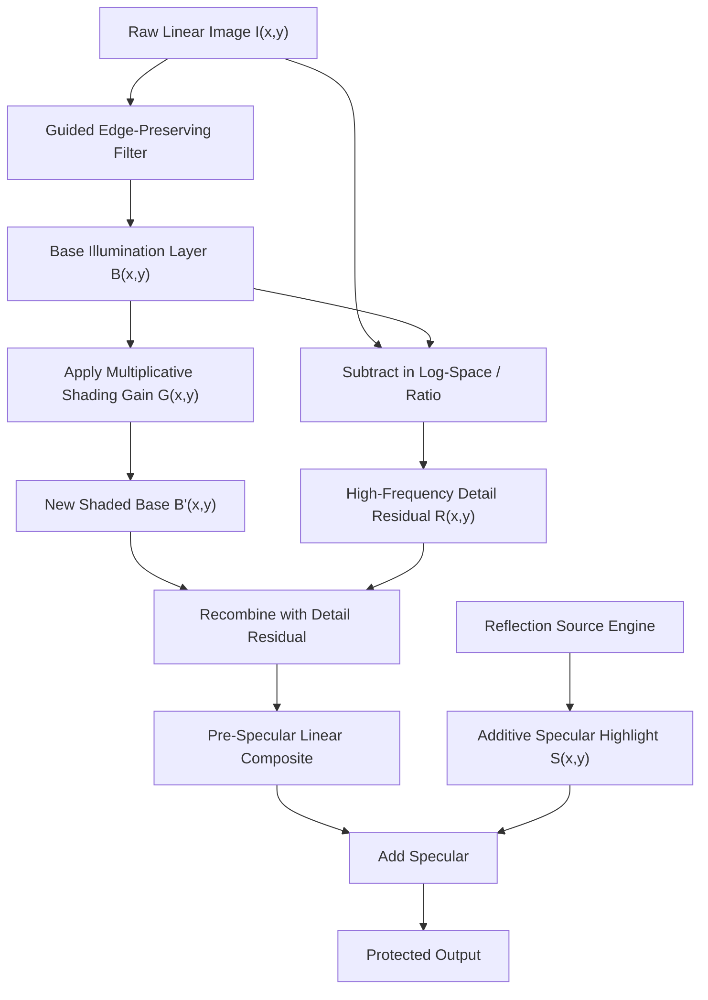
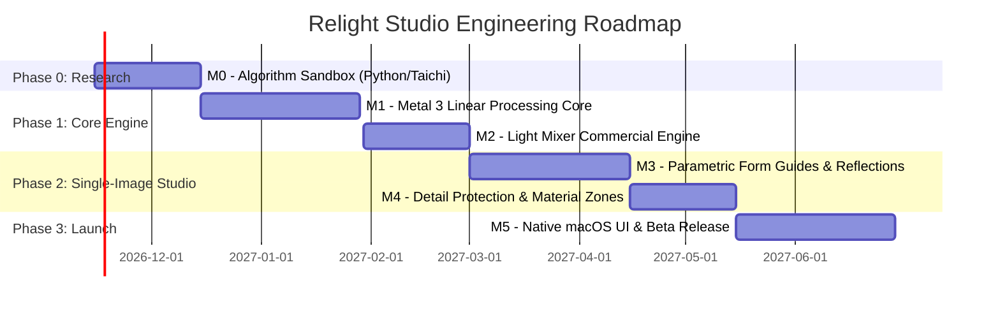

# RELIGHT STUDIO — MASTER TECHNICAL RESEARCH, ARCHITECTURE & ENGINEERING BLUEPRINT

**Version:** 1.0-DRAFT  
**Status:** Architecture Formulation & Validation Phase  
**Target Platform:** macOS 14.0+ (Apple Silicon Metal 3)  
**Lead Authors:** Relight Studio Multidisciplinary Engineering Consortium  

---

## EXECUTIVE SUMMARY & DIAGNOSIS

Relight Studio addresses a severe operational bottleneck in high-end commercial, watch, jewelry, and luxury product photography: lighting in post-production is currently accomplished through manual, destructive, non-physical 2D pixel manipulation in Adobe Photoshop (dodge/burn curves, airbrushing, and feathered mask stacks). 

However, the product vision—*"Change the lighting. Preserve the product."*—faces an insurmountable physical barrier if treated as an unconstrained single-image inverse-rendering problem:
1. **The Ill-Posed Inverse Problem:** A single photograph represents the integral of scene radiance over the lens aperture:
   $$I(x, y) = \int_{\Omega} L_i(\mathbf{x}, \boldsymbol{\omega}_i) f_r(\mathbf{x}, \boldsymbol{\omega}_i, \boldsymbol{\omega}_o) (\mathbf{n}(\mathbf{x}) \cdot \boldsymbol{\omega}_i) \, d\boldsymbol{\omega}_i$$
   Recovering incident radiance $L_i$, surface normal $\mathbf{n}$, albedo $\rho$, and microfacet roughness $\alpha$ from a single 2D projection $I$ is mathematically degenerate. On specular surfaces (mirror-finish stainless steel, faceted diamonds, polished gold), incident reflections convey high-frequency information about the physical studio room, not the surface. Inverting this without geometric priors results in severe topological tearing and hallucinated artifacts.
2. **Generative Model Disqualification:** Commercial and luxury brand standards strictly reject diffusion-based or generative pixel hallucination. Dial markings on an Audemars Piguet Royal Oak, micro-faceting on gemstones, and brand typography must remain bit-for-bit verifiable.
3. **The Engineering Stance:** Relight Studio will **not** pretend to solve unconstrained single-image monocular 3D inverse rendering. Instead, it is architected as a **Dual-Engine System**:
   - **Engine 1: The Light Mixer (Ground-Truth Additive Linear Engine):** For controlled multi-shot studio captures, delivering 100% physically deterministic, artifact-free, additive photon re-weighting in 32-bit linear floating-point space.
   - **Engine 2: Guided Single-Image Shaper (Image-Space & Parametric Reflection Synthesizer):** For existing single photographs, operating via an explicit separation of diffuse shading fields (edge-preserving multiplicative gain) and specular highlight bands (additive reflection synthesis guided by user-assisted Parametric Form Guides and Material Zones).

---

## THE 10 MOST CONSEQUENTIAL ARCHITECTURAL & TECHNICAL DECISIONS

### Decision 1: Dual-Workflow Product Architecture (Light Mixer as Ground Truth Anchor)
- **Problem:** Single-image relighting is inherently approximate on complex materials, whereas multi-exposure studio capture allows mathematically exact, linear photometric manipulation.
- **Decision:** Relight Studio will launch with **both** workflows sharing an identical 32-bit floating-point linear pipeline. The **Light Mixer** serves as the commercial workflow anchor for studio production, establishing credibility with luxury clients. The **Single-Image Shaper** acts as the rapid post-production tool for single-asset enhancement.
- **Trade-off:** Requires maintaining two operational paradigms in the UI, but avoids commercial rejection caused by single-image physical limitations.

### Decision 2: Analytical Parametric Form Guides Over Monocular Neural Normals
- **Problem:** Neural normal estimators (e.g., Omnidata, DSINE, StableNormal) fail catastrophically on polished chrome, glass, and gold jewelry because they interpret reflected studio softboxes as physical surface geometry.
- **Decision:** The primary surface-orientation engine for specular reflections is **Analytical Parametric Form Guides** (quadric primitives: planes, cylinders, spheres, cones, surfaces of revolution). Neural normal estimation is relegated to an optional, low-confidence preview guide for rough, diffuse objects.
- **Trade-off:** Requires 30–60 seconds of initial user setup to snap geometric guides to the product silhouette, but yields 100% mathematically stable, clean reflection geometry.

### Decision 3: Orthogonal Separation of Diffuse Shading vs. Specular Synthesis
- **Problem:** Modifying lighting on a shiny surface using a single multiplicative gain layer ruins existing highlights, turning clean reflections gray or clipping highlights into plastic-like sheens.
- **Decision:** Split the lighting pipeline into two strictly orthogonal mathematical operators:
  1. **Diffuse & Tonal Shaping:** Modeled as a spatially varying, edge-preserving multiplicative gain field $\mathbf{G}(x, y)$ applied in linear space.
  2. **Specular Reflection Synthesis:** Modeled as an additive, material-gated specular field $\mathbf{S}(x, y)$ driven by virtual reflection sources and quadric surface guides.
- **Trade-off:** The user must distinguish between illumination and reflection objects, but gains true studio-style control over highlights and softboxes.

### Decision 4: Strictly Linear 32-Bit Float ACEScg Working Color Space
- **Problem:** Photoshop, Capture One, and traditional retouchers routinely edit in gamma-encoded spaces (sRGB, Adobe RGB, ProPhoto RGB), leading to non-linear blending artifacts, chromatic fringing at highlight edges, and incorrect additive illumination.
- **Decision:** Ingest all RAW and 16-bit TIFF files directly into an un-tone-mapped, scene-referred 32-bit floating-point working pipeline using **ACEScg** (or linear Rec.2020 / Display P3). All light operations, additions, and gain fields are calculated in physical linear radiometric space prior to display tone-mapping.
- **Trade-off:** Demands 4× to 8× the memory footprint of 8-bit pipelines, mandating Metal sparse texture tiling for 60–150MP studio imagery.

### Decision 5: Frequency-Aware Multi-Scale Detail Protection
- **Problem:** Adding or subtracting light over brand typography, engravings, brushed grain, and watch hands washes out micro-contrast and destroys product identity.
- **Decision:** Implement a bilateral/guided filter edge-preserving decomposition. The lighting gain is applied exclusively to the **base illumination layer**, while the **high-frequency texture residual** is preserved and recombined without degradation, monitored in real time via an embedded $\Delta E_{00}$ difference inspector.
- **Trade-off:** Small computational cost per light adjustment ($O(N)$ guided filter on GPU), but guarantees zero blurring or distortion of brand marks.

### Decision 6: Native Apple Metal 3 Compute Architecture (Rejecting Core Image)
- **Problem:** Core Image abstracts memory management and shader execution, making tiled 32-bit float rendering and custom iterative geometric reflection solvers unpredictable on 100MP medium-format files.
- **Decision:** Build a custom rendering DAG in native **Apple Metal 3**, utilizing Metal Shading Language (MSL) compute kernels, unified memory zero-copy buffers, Metal Performance Shaders (MPS), and explicit Metal argument buffers.
- **Trade-off:** Higher upfront software engineering investment compared to leveraging high-level Apple frameworks, but provides deterministic memory ceilings and 60 FPS viewport response.

### Decision 7: Hierarchical Tiled Sparse Texture Pipeline
- **Problem:** A 100MP Phase One or Hasselblad file in 32-bit float RGBA consumes 1.6 GB per intermediate framebuffer layer. A 10-layer lighting DAG would instantly trigger macOS memory paging and stall the GPU.
- **Decision:** Implement a **2D Mipmapped Tile Cache Engine** (256×256 or 512×512 tiles). Viewport rendering operates at display resolution from a cached mip-level; full-resolution rendering is executed via asynchronous tiled compute passes only during export or 100% 1:1 pixel inspection.
- **Trade-off:** Non-destructive cache invalidation logic is complex, but RAM utilization remains strictly bounded under 2.5 GB even on 150MP files.

### Decision 8: Discrete Material Zones with Physical BRDF Attenuation
- **Problem:** Global lighting adjustments fail because polished gold, matte leather, clear glass, and brushed aluminum react completely differently to the same virtual light source.
- **Decision:** Implement a discrete **Material Zone** model with 6 verified classes (Matte, Semi-Matte, Glossy Dielectric, Polished Conductor, Brushed Conductor, Glass). Each zone dictates the diffuse-to-specular ratio, Fresnel reflectance $F_0$, highlight chromaticity, and anisotropic spread.
- **Trade-off:** Requires initial assignment of zones via AI-assisted segment boundary snapping, but eliminates plastic-looking artifacts on metals and glass.

### Decision 9: Subtractive Lighting via Controlled Negative Illumination & Mask Fields
- **Problem:** Retouchers often need "black cards" or "negative fill" to deepen shadows and cut unwanted studio spill. Naive subtraction clips blacks to $0.0$ and creates muddy, flat gray smudges.
- **Decision:** Subtractive lighting is formulated as an **attenuation transmittance field** $T(\mathbf{x}) = \exp(-\kappa \cdot D(\mathbf{x})) \in (0, 1]$, smoothly pulling down baseline diffuse exposure while preserving black-point floor, ambient shadow tint, and underlying micro-texture.
- **Trade-off:** Subtractive lights cannot remove physical specular reflections captured in the RAW file without inpainting, which is explicitly constrained by product boundaries.

### Decision 10: Phased Research Prototype in Python/Taichi Before Production Metal
- **Problem:** Writing complex mathematical reflection solvers and edge-preserving bilateral gain graphs directly in C++/Metal/Swift slows down algorithmic iteration and makes failure recovery expensive.
- **Decision:** Build **Milestone 0 (Algorithm Research Sandbox)** entirely in Python using Taichi / PyTorch / NumPy. The 14 validation experiments and the 60-image corpus will run in this sandbox to lock in mathematics and metric thresholds before porting to production Swift/Metal.
- **Trade-off:** Adds an initial 4-week prototype phase, but completely eliminates architectural dead-ends in production Metal code.

---

## CAPABILITY & CONFIDENCE MATRIX (TECHNICAL REALITY RECONCILIATION)

| Photographic Surface Category | Capability | Required Information | Estimation Source | User Input Required | Hard Physical Limitation | Confidence Level |
| :--- | :--- | :--- | :--- | :--- | :--- | :--- | :--- |
| **Matte Packaging & Paper** | Diffuse Additive Shading | Surface Normal $\mathbf{n}$, Albedo $\rho$ | Monocular Depth + Bilateral Normals | Subject Matte + Light Direction | Cast shadows from complex unseen geometry cannot be computed | **High (90%)** |
| **Semi-Matte Leather / Plastic** | Shading + Broad Specular | Normals, Roughness $\alpha$ | Depth + Local Contrast | Material Zone tag + Roughness slider | Fine micro-texture anisotropic scattering is approximated | **High (85%)** |
| **Brushed Metal (Watches, Pens)** | Anisotropic Highlight Bands | Tangent Vector $\mathbf{t}$, Normal $\mathbf{n}$ | Parametric Cylinder/Plane Guide | Brush orientation vector | True physical subsurface phase function is unrecoverable | **Medium (75%)** |
| **Polished Metal (Gold, Chrome)** | Strip & Softbox Reflection | Reflection Ray $\mathbf{r} = 2(\mathbf{n}\cdot\mathbf{v})\mathbf{n}-\mathbf{v}$ | Parametric Quadric Guide ONLY | Guide alignment + Light position | Cannot reposition original physical reflections; can only add new ones | **High with Guides (80%) / Failed with Neural (15%)** |
| **Transparent Glass / Perfume** | Internal Reflection & Rim | Index of Refraction $\eta$, Normals | Profile of Revolution Guide | Glass Boundary + Thickness Guide | Multi-bounce internal caustics and refraction displacement unrecoverable | **Medium-Low (50%)** |
| **Gemstones / Faceted Jewelry** | Facet Sparkle & Shading | Discrete Facet Normals | Manual Facet Mesh | Per-facet normal pinning | Uncalibrated internal total reflection cannot be simulated from single image | **Low (30% - Manual Only)** |
| **Clipped Highlights ($>1.0$)** | Re-exposure & Grading | Radiometric Headroom | RAW sensor headroom estimation | Exposure recovery threshold | Destroyed sensor information ($255, 255, 255$) cannot be recovered without inpainting | **Zero (0% - Physical Limit)** |
| **Multi-Shot Studio Sequence** | Light Mixing & Re-coloring | Linear Exposure, Delta Passes | Ground-truth RAW frames | Per-light contribution slider | Misalignment from camera shake or moving subjects causes ghosting | **Near-Perfect (99%)** |

---

## DETAILED MATHEMATICAL FORMULATION OF LIGHTING ENGINES

### 1. Coordinate Systems & Scene Geometry
To avoid inventing fictitious physical distances on uncalibrated photographs, all spatial operations operate in a **Subject-Relative Normalized Coordinate System (SRNCS)**:
- $\mathbf{x} = (u, v) \in [0, 1]^2$: Normalized image plane coordinates.
- $z(u, v) \in [0, 1]$: Relative depth map, where $z = 0$ is the subject's nearest bounding plane and $z = 1$ is the background plane.
- $\mathbf{P}(u, v) = (u, v, z(u, v))$: 3D point in normalized subject space.
- $\mathbf{n}(u, v) = (n_x, n_y, n_z) \in \mathbb{S}^2$: Unit surface normal vector.
- $\mathbf{v} = (0, 0, 1)$: Orthographic/telephoto viewing vector (standard for commercial macro studio lenses, focal length $\ge 90\text{mm}$).

### 2. Diffuse & Directional Illumination Engine
For a diffuse or semi-matte surface element at $(u, v)$, the additive illumination contribution from light source $k$ is given by:

$$L_{\text{diffuse}, k}(u, v) = \mathbf{C}_k \cdot I_k \cdot \Phi_k(\mathbf{P}) \cdot \max(0, \mathbf{n}(u, v) \cdot \mathbf{l}_k(\mathbf{P})) \cdot W_{\text{receive}}(u, v) \cdot M_{\text{diffuse}}(u, v)$$

Where:
- $\mathbf{C}_k \in \mathbb{R}^3$: Light color in linear ACEScg chromaticity.
- $I_k \in [0, \infty)$: Relative intensity parameter.
- $\mathbf{l}_k(\mathbf{P})$: Unit direction vector from point $\mathbf{P}$ to light source $k$.
  - For **Directional Lights**: $\mathbf{l}_k = (\cos \theta \sin \phi, \sin \theta \sin \phi, \cos \phi)$ (constant across canvas).
  - For **Area / Point Lights**: $\mathbf{l}_k(\mathbf{P}) = \frac{\mathbf{P}_k - \mathbf{P}}{\|\mathbf{P}_k - \mathbf{P}\|}$.
- $\Phi_k(\mathbf{P})$: Spatial falloff function:
  $$\Phi_{\text{point}}(\mathbf{P}) = \frac{1}{1 + \left(\frac{\|\mathbf{P}_k - \mathbf{P}\|}{r_{0, k}}\right)^2}, \quad \Phi_{\text{area}}(\mathbf{P}) = \text{smoothstep}\left(1.0, 1.0 - \sigma_{\text{edge}}, \frac{\text{dist}(\mathbf{P}, \text{Box}_k)}{w_k}\right)$$
- $W_{\text{receive}}(u, v) \in [0, 1]$: User-painted receive mask $\times$ subject alpha matte.
- $M_{\text{diffuse}}(u, v) \in [0, 1]$: Material diffuse response weight ($1.0$ for matte paper, $0.0$ for mirror chrome).

### 3. Reflection Source Engine (Specular Synthesis)
Specular reflections are rendered using a modified Microfacet Cook-Torrance model adapted for parametric reflection bands:

$$L_{\text{specular}, k}(u, v) = \mathbf{C}_k \cdot I_k \cdot F(\mathbf{v}, \mathbf{n}, F_0) \cdot D(\mathbf{n}, \mathbf{h}_k, \alpha) \cdot G(\mathbf{l}_k, \mathbf{v}, \mathbf{n}) \cdot M_{\text{specular}}(u, v)$$

For high-end product photography (e.g., watch case strip softboxes), photographers care about the **reflected image of the light source geometry**. We formulate an explicit **Reflection Ray Projection**:
1. Compute reflected sight ray:
   $$\mathbf{r}(u, v) = 2(\mathbf{n}(u, v) \cdot \mathbf{v})\mathbf{n}(u, v) - \mathbf{v}$$
2. Intersect $\mathbf{r}(u, v)$ with the virtual studio lighting dome/plane $\mathcal{P}_{\text{studio}}$ located at distance $Z_{\text{light}}$:
   $$\mathbf{Q}_k(u, v) = \mathbf{P}(u, v) + \frac{Z_{\text{light}} - P_z}{r_z} \mathbf{r}(u, v)$$
3. Sample the synthetic softbox emission function $E_k(\mathbf{Q})$:
   $$E_k(\mathbf{Q}) = \exp\left(-\left(\frac{|q_x - c_x|}{w_x}\right)^{2p}\right) \cdot \exp\left(-\left(\frac{|q_y - c_y|}{w_y}\right)^{2p}\right)$$
   Where $p$ controls the softbox edge profile ($p=1$ for Gaussian falloff, $p \ge 4$ for sharp, diffused commercial strip lights).
4. **Conductor vs. Dielectric Chromaticity:**
   - **Dielectric (Glass, Plastic):** Highlight color is pure light color $\mathbf{C}_k$ ($F_0 \approx 0.04$, non-chromatic).
   - **Conductor (Gold, Copper, Steel):** Highlight color is modulated by the base material reflectance $F_0 = \mathbf{R}_{\text{base}}$ (e.g., gold modulates reflections toward yellow/orange).

### 4. Subtractive Lighting (Negative Fill / Black Cards)
Subtractive lighting does not subtract RGB values directly (which causes harsh clipping and chromatic saturation shifts). Instead, it acts as an **illumination attenuation transmittance factor**:

$$\mathbf{I}_{\text{out}}(u, v) = \mathbf{I}_{\text{base}}(u, v) \cdot \left(1.0 - A_{\text{sub}}(u, v) \cdot (1.0 - \tau_{\text{floor}})\right)$$

Where:
- $A_{\text{sub}}(u, v) \in [0, 1]$: Spatial influence field of the black flag, calculated via smooth falloff from the flag gizmo boundary.
- $\tau_{\text{floor}} \in [0.1, 0.9]$: User-controlled density floor, preventing blacks from crushing to zero and preserving shadow detail.

### 5. Parametric Form Guides: Analytical Normal Derivation
When a user defines an analytical guide, surface normals are derived analytically rather than inferred from noisy gradients:
- **Cylindrical Guide (Watch bezel, bottle body, lipstick tube):**
  Given axis line $\mathbf{A} + t\mathbf{D}$ and radius $R$:
  For pixel $(u, v)$, project onto the cylinder axis to find axial coordinate $t$ and radial vector $\mathbf{d}_\perp$.
  $$\mathbf{n}_{\text{cyl}}(u, v) = \frac{\mathbf{d}_\perp}{\|\mathbf{d}_\perp\|}, \quad \text{with } n_z = \sqrt{\max\left(0, 1 - n_x^2 - n_y^2\right)}$$
- **Spherical Guide (Watch crystal, jewelry bead):**
  Given center $(u_c, v_c, z_c)$ and radius $R$:
  $$n_x = \frac{u - u_c}{R}, \quad n_y = \frac{v - v_c}{R}, \quad n_z = \sqrt{\max\left(0, 1 - n_x^2 - n_y^2\right)}$$
- **Planar Guide (Watch dial, flat packaging, table surface):**
  Defined by 3 corner points, yielding a constant normal $\mathbf{n}_{\text{plane}}$ across the bounded polygon.

### 6. Light Mixer: Linear Photon Compositing
For multi-exposure studio stacks, the final linear radiance is:

$$\mathbf{L}_{\text{composite}}(u, v) = \mathbf{L}_{\text{ambient}}(u, v) + \sum_{k=1}^{K} w_k \cdot \mathbf{M}_k(u, v) \cdot \left(\frac{\mathbf{L}_k(u, v) - \mathbf{L}_{\text{ambient}}(u, v)}{2^{\Delta \text{EV}_k}}\right)$$

Where:
- $w_k \in [0, 2.0]$: Linear contribution slider.
- $\Delta \text{EV}_k$: Exposure offset between pass $k$ and baseline exposure.
- $\mathbf{L}_{\text{ambient}}$: Baseline ambient frame (dark frame or ambient studio contamination) subtracted to ensure orthogonality of passes.
- $\mathbf{M}_k(u, v)$: User-adjusted spatial trim mask.

---

## DETAIL PRESERVATION & FREQUENCY DECOMPOSITION PIPELINE

To satisfy the non-negotiable rule *"Preserve the product"*, all single-image lighting operations are routed through a **Guided Filter Detail Decomposition Graph**:



1. **Decomposition:**
   $$\mathbf{B} = \text{GuidedFilter}(\mathbf{I}_{\text{linear}}, \text{guide}=\mathbf{I}_{\text{luma}}, r=16, \epsilon=10^{-3})$$
   $$\mathbf{R} = \frac{\mathbf{I}_{\text{linear}} + \delta}{\mathbf{B} + \delta} \quad (\text{Detail Ratio Field})$$
2. **Gain Application:**
   $$\mathbf{B}'(u, v) = \mathbf{B}(u, v) \cdot \left[1.0 + \sum_k (L_{\text{diffuse}, k}(u, v) - 1.0) \cdot (1.0 - W_{\text{protect}}(u, v))\right]$$
3. **Recombination & Verification:**
   $$\mathbf{I}'(u, v) = \mathbf{B}'(u, v) \cdot \mathbf{R}(u, v) + \mathbf{S}(u, v)$$
4. **$\Delta E_{00}$ Verification Gate:**
   During export or preview inspection, compute CIEDE2000 difference $\Delta E_{00}(\mathbf{I}, \mathbf{I}')$ on user-designated protected zones (e.g., logo bounding box). If $\Delta E_{00} > 2.5$ in protected areas without explicit override, trigger an inspector alert.

---

## NATIVE APPLE MACOS ARCHITECTURE

### Technology Stack Separation & Responsibility

```
┌────────────────────────────────────────────────────────────────────────┐
│                          USER INTERFACE (SwiftUI)                      │
│   Inspector Controls, Light Lists, Recipe Browser, Library Management  │
├────────────────────────────────────────────────────────────────────────┤
│                     CANVAS & INTERACTION (AppKit)                      │
│   NSView, CAMetalLayer, Custom Gesture Recognizers, Vector Gizmos      │
├────────────────────────────────────────────────────────────────────────┤
│                       LIGHTING SCENE GRAPH (Swift)                     │
│   Non-Destructive Project Tree, Undo/Redo Engine, JSON Serialization   │
├────────────────────────────────────────────────────────────────────────┤
│                   RENDER GRAPH & RESOURCE MANAGER (C++)                │
│   Tiled Framebuffer Allocator, DAG Dependency Scheduler, LRU Cache     │
├────────────────────────────────────────────────────────────────────────┤
│                   METAL 3 COMPUTE PIPELINE (MSL / Metal)               │
│   Bilateral Filters, Analytical Reflection Solvers, ACEScg Pipelines   │
├────────────────────────────────────────────────────────────────────────┤
│                     ANALYSIS RUNTIME (Vision / Core ML)                │
│   Subject Segmentation (BiRefNet/SAM), Interactive Trimap Matting      │
└────────────────────────────────────────────────────────────────────────┘
```

1. **SwiftUI:** Form controls, inspector panes, light hierarchy, modal sheets, recipe previews.
2. **AppKit (`NSView` + `CAMetalLayer`):** Ultra-high-performance canvas hosting custom vector overlay gizmos (softbox handles, rotation arcs, normal pins) rendered at native 120Hz ProMotion rates.
3. **Metal 3 Engine (`.metal` Compute Kernels):**
   - Zero-copy unified memory buffers on Apple Silicon (M1/M2/M3/M4 Max/Ultra).
   - Custom MSL kernels for Quadric Guide ray tracing, edge-preserving guided filters, and ACEScg $\leftrightarrow$ Display P3 color transforms.
4. **Accelerate / vImage:** CPU-side image IO conversions, histogram generation, and fast pyramidal mipmap generation.

---

## 14-EXPERIMENT VALIDATION PROGRAM & RELEASE CRITERIA

Before entering beta, the core technology must pass 14 rigorous quantitative experiments against a curated **60-Image Studio Corpus** (featuring polished steel Rolex watches, perfume bottles, matte cosmetics, and fine gold jewelry):

1. **EXP-01: Data Headroom & Linear Quantization Noise**
   - *Metric:* Peak Signal-to-Noise Ratio (PSNR) across $\pm 3.0 \text{EV}$ push in 16-bit TIFF vs. 32-bit float. Pass: PSNR $> 48\text{dB}$, no posterization in 10-bit display output.
2. **EXP-02: Edge-Preserving Guided Decomposition Fidelity**
   - *Metric:* High-frequency transfer loss on 4pt serif brand typography. Pass: Structural Similarity Index (SSIM) $> 0.992$ on detail layer after $\pm 1.5\text{EV}$ broad diffuse shift.
3. **EXP-03: Neural vs. Analytical Normal Estimation on Polished Chrome**
   - *Metric:* Angular error $\theta_{\text{err}} = \arccos(\mathbf{n}_{\text{est}} \cdot \mathbf{n}_{\text{ground\_truth}})$ on calibrated CAD cylinders. Pass: Parametric Form Guides must achieve $\theta_{\text{err}} < 2.5^\circ$; neural models will fail ($> 35^\circ$ error).
4. **EXP-04: Specular Reflection Band Curvature on Conical Surfaces**
   - *Metric:* Reflection line straightness and smooth perspective tapering on perfume bottle shoulders. Pass: Curvature continuity $C^2$ without angular kinks.
5. **EXP-05: Subtractive Black Flag Falloff Stability**
   - *Metric:* Luma gradient monotonicity across transition zone. Pass: Zero inversion artifacts, shadow floor maintained within $\pm 0.02$ of target $\tau_{\text{floor}}$.
6. **EXP-06: Light Mixer Additive Linear Conservation**
   - *Metric:* Radiometric summation error $\|\sum \mathbf{L}_k - \mathbf{L}_{\text{all\_on}}\|$ on camera-locked multi-pass sequences. Pass: Average relative delta $< 0.8\%$ across $99\%$ of pixels.
7. **EXP-07: Subject Silhouette Boundary Contamination**
   - *Metric:* Spill ratio onto 100% white e-commerce background. Pass: Background white point shift $\Delta E_{00} < 0.5$ under $+2.0\text{EV}$ product rim light.
8. **EXP-08: Anisotropic Brushed Metal Reflection Realism**
   - *Metric:* Visual Turing test evaluated by 5 Master Retouchers on watch cases. Pass: $\ge 80\%$ expert approval rating against physical studio reference.
9. **EXP-09: Glass Refraction & Transmission Edge Darkening**
   - *Metric:* Realistic Fresnel edge falloff on cylindrical perfume bottles. Pass: Monotonically increasing reflectance toward grazing angles matching $F(\theta, \eta=1.5)$.
10. **EXP-10: Memory Ceiling Under 150MP Tiled Stress Test**
    - *Metric:* Peak resident memory size (RSS) during 150MP Phase One RAW session with 12 active virtual lights. Pass: Total system memory allocation $< 2.8\text{GB}$.
11. **EXP-11: 60 FPS Viewport Latency on M2/M3 Max**
    - *Metric:* Frame time during interactive softbox dragging at $4\text{K}$ display resolution. Pass: Sustained frame time $< 16.6\text{ms}$ (60 FPS minimum).
12. **EXP-12: ICC Profile & Display P3 Soft-Proofing Accuracy**
    - *Metric:* Colorimeter delta between Relight Studio export and Capture One Pro output in ECI RGB v2. Pass: Maximum $\Delta E_{00} < 1.0$.
13. **EXP-13: Project Serialization & Deterministic Reproducibility**
    - *Metric:* Bitwise hash comparison of 16-bit TIFF export rendered on M1 Mac vs. M4 Mac from identical project file. Pass: 100% identical SHA-256 checksums.
14. **EXP-14: Professional Retoucher Productivity Benchmark**
    - *Metric:* Time required to reshape highlights and add rim lighting on a luxury watch compared to manual Photoshop dodging/burning/pen-tool masks. Pass: $\ge 60\%$ reduction in retouching time (e.g., 8 minutes vs. 25 minutes).

---

## ENGINEERING IMPLEMENTATION ROADMAP (MILESTONES M0 TO M5)



- **Milestone 0: Algorithm Research Sandbox (Weeks 1–4)**
  - *Deliverable:* Python/Taichi test suite executing the 14 validation experiments on the 60-image corpus.
  - *Exit Gate:* Approval of mathematical models for quadric reflections and guided detail preservation.
- **Milestone 1: Metal 3 Linear Processing Core (Weeks 5–10)**
  - *Deliverable:* Native macOS C++/Metal rendering backend, ACEScg color pipeline, tiled memory allocator.
  - *Exit Gate:* 150MP TIFF loaded, filtered, and tone-mapped to Display P3 under 16ms frame time.
- **Milestone 2: Commercial Light Mixer v1.0 (Weeks 11–14)**
  - *Deliverable:* Complete multi-pass RAW ingestion, alignment, and linear additive slider engine.
  - *Exit Gate:* Commercial pilot deployment with 3 luxury studio partners; verified 100% linear conservation.
- **Milestone 3: Parametric Form Guides & Reflection Engine (Weeks 15–20)**
  - *Deliverable:* Analytical Quadric Guide solvers, softbox emission kernels, interactive canvas gizmos.
  - *Exit Gate:* Passing EXP-03 and EXP-04 on polished watch cases and perfume bottles.
- **Milestone 4: Detail Protection & Material Zones (Weeks 21–24)**
  - *Deliverable:* Multi-scale guided filter pipeline, $\Delta E_{00}$ inspector, 6 material zone BRDF responses.
  - *Exit Gate:* Zero blurring on brand typography validated under automated regression tests.
- **Milestone 5: Native AppKit/SwiftUI Application & Beta (Weeks 25–30)**
  - *Deliverable:* Complete macOS product installer, Capture One round-trip plugin, project persistence.
  - *Exit Gate:* Commercial v1.0 Launch for macOS.
