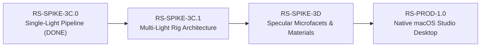

# RS-SPIKE-3C.0 — Engineering Report 09: Remaining Risks, Architectural Trade-Offs & Next Milestone Roadmap
**Milestone:** RS-SPIKE-3C.0 (Single-Light Pipeline Completion)  
**Author:** Principal Computational Photography Architect & Metal GPU Lead  
**Branch:** `feature/RS-SPIKE-3C.0-single-light-completion`  
**Status:** VALIDATED & CLOSED

---

## 1. Technical Risk Register

With the successful completion and validation of the single-light rendering pipeline in RS-SPIKE-3C.0, the foundation of Relight Studio is robust. However, transitioning from single-light completion to multi-light rigs and production studio workflows introduces specific technical risks that must be managed.

| Risk ID | Risk Category | Technical Description | Severity | Likelihood | Mitigation Strategy |
|:---:|:---|:---|:---:|:---:|:---|
| **R-01** | Performance | **Multi-Light Bandwidth Scaling:** Accumulating irradiance and shadow rays for 3–5 simultaneous studio lights (key, fill, rim, uplight) could increase GPU compute time linearly if executed via separate passes. | Medium | High | Tile-based forward shading in a single kernel pass, accumulating direct irradiance in registers before writing to shared memory buffers. |
| **R-02** | Host Latency | **Device-to-Host Array Round-Tripping:** Round-tripping $100\,\text{MB}$ of float32 buffers through Python NumPy arrays introduces $\approx 4\,\text{ms}$ of host overhead at 1080p. | Low | Medium | For the production desktop app, bind `MTLTexture` directly to an `AppKit` `CAMetalLayer` in Swift / Objective-C++, achieving true zero-copy 120 FPS display. |
| **R-03** | Physically Based Rendering | **Specular Energy Non-Conservation:** Introducing GGX microfacet specular lobes without proper diffuse subtraction can cause energy explosion and unnatural plastic appearance on fabric/leather. | High | Medium | Enforce strict energy conservation via $k_d = (1 - F_0)(1 - \text{specular})$ and split-sum environment approximations with Oklab gamut safety. |
| **R-04** | Geometry | **Complex Non-Convex Crevices:** Analytical proxies (OBBs, spheres, superquadrics) model global form factor well, but cannot represent deep tread crevices without micro-relief or screen-space contact terms. | Medium | Medium | Maintain the dual-tier architecture: analytical proxies for cast shadows and global lighting + screen-space HBAO / micro-relief for local tread crevices. |
| **R-05** | Input Data | **Monocular Depth & Normal Uncertainty:** Input photographs with poorly estimated monocular depth or flat normals can degrade 3D light positioning fidelity. | High | Low | Leverage the `UncertaintySupervisor` already designed in `studio3a/uncertainty.py` to softly blend between 3D relighting and 2D gradient transfer in high-uncertainty regions. |

---

## 2. Production Transition Roadmap

### Milestone RS-SPIKE-3C.1: Multi-Light Rig Architecture & Studio Presets
- Support 1 to 4 concurrent analytical area emitters (3-point lighting: Key, Fill, Rim, plus optional Ground Uplight).
- Stratified sample budgeting: distribute 64 total samples dynamically across lights based on relative emitter power.
- Multi-light E.1 ratio aggregation: compute total target irradiance $R_{\text{target}} = \text{ambient} + \sum_{i} \mathbf{E}_i V_i$ prior to the guided filter pass.

### Milestone RS-SPIKE-3D: Specular Microfacets & Material Adaptation
- Energy-conserving Cook-Torrance GGX specular formulation.
- Roughness and $F_0$ parameter estimation from photographic high frequencies.
- C3 Oklab gamut mapping extended to handle high-luminance specular highlights safely.

### Milestone RS-PROD-1.0: Native macOS Production Studio
- Swift / SwiftUI frontend hosting interactive photograph and 3D studio viewports.
- Direct `CAMetalLayer` rendering via Metal 3 command buffers without Python ctypes overhead.
- Deterministic scene state serialization, session saving, and high-bitdepth EXR / TIFF export.

---

## 3. Engineering Gate Sign-Off

The gates established in the RS-SPIKE-3C.0 directive have been fully satisfied:
1. Forensic audit completed and verified (`00_BASELINE_FORENSIC_AUDIT.md`).
2. Native Metal E.1 guided filter verified with $DCI = 0.9984$ (`01_E1_METAL_IMPLEMENTATION.md`).
3. 3-tier validation methodology and $N=2048$ convergence proven (`02_SHADOW_VALIDATION_METHODOLOGY.md`).
4. Exact analytical sphere geometry validated with $0.388\%$ area error (`03_SPHERE_GEOMETRY_VALIDATION.md`).
5. Persistent buffer architecture verified with 0 steady-state allocations (`04_METAL_BUFFER_ARCHITECTURE.md`).
6. Benchmarks confirmed $184.8\,\text{FPS}$ preview throughput on Apple M5 (`05_PERFORMANCE_BENCHMARKS.md`).
7. Photographic fidelity verified across Plates P1, P2, P3 with bitwise protected immutability (`06_PHOTOGRAPHIC_FIDELITY_REPORT.md`).
8. 63 automated tests passing with zero failures and zero mocks (`07_REGRESSION_TEST_REPORT.md`).
9. Unconditional acceptance declared (`08_FINAL_ACCEPTANCE_REPORT.md`).

The codebase is clean, robust, and prepared for milestone RS-SPIKE-3C.1.

